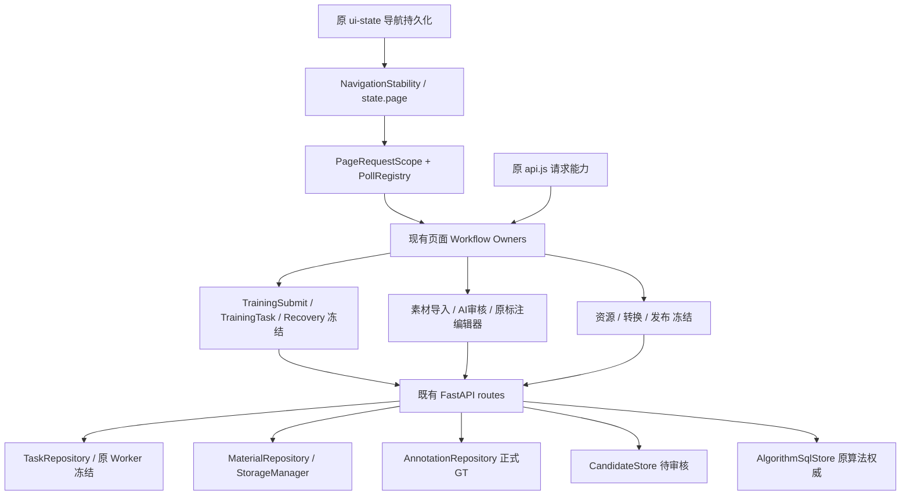

# 证据限定架构整改｜训练主链冻结

用户补充高于原附件：只修可复现缺陷，不因行数、window、Observer、兼容层或多模块进行重构。
基线42.24.557 / 08a3c2b02f52277339c226ff6ff961ce57a69f5f，远端一致、准确CI22/22成功。
隔离克隆D:/lab/yolosuanfa/aixunlianpingtai-review-20261106；用户WIP只读，生产/A800/4070不访问、不部署。

## 不变边界及基线

原MaterialRepository、AnnotationRepository、CandidateStore、NegativePool、TaskRepository、Worker、Provider、
请求/导航/缓存、转换与远程节点Owner保留。预设账号密码保持不变。
训练参数/默认值、首训/迭代、母模型、标签、划分、历史隔离、准入、快照、GPU/Worker状态机及版本归档冻结。
Git blob与app训练相关定义AST摘要记录在evidence/architecture-2026-11-07/frozen-training-baseline.json。
基线算法SQL/负样本45通过；训练lineage/label/split/precision/resource/snapshot133通过、1跳过。
负样本Node11通过、原Chrome4通过；ZIP125通过1跳过；远程启动/升级合同8通过。
上述均隔离测试，不是现场验证。测试有重叠，不加总。

## P0-1：已证明鉴权缺陷，现场使用未知，本轮不改

1. 实际链：app startup→旧maintenance→旧队列dispatcher→_v48_launch_saved_job→X-API-Key POST /api/remote/train；
   新Node Agent链独立存在，但不能证明旧链现场已退役。旧SH/BAT入口仍在，未找到systemd/Docker定义不能推出现场未部署。
2. 缺陷：remote_train_server.check_key为空时放行；config POST不校验，可清空已有key。
3. 隔离复现：临时目录设置key后无key GET=401，未授权config清空=200，同一GET=404，证明绕过认证。
   没有调用health/train/GPU/Worker，没有读生产配置或密钥。
4. 现有8项只保护启动/设备/升级合同，没有保护该认证场景。
5. 最小候选仅旧服务鉴权及受控bootstrap，须先有现场实际使用证据；按本轮约束不实施。
6. 影响：若真实可达，未授权客户端可改key并访问旧任务入口；未部署则仅潜在代码风险。不能声称公网已暴露或生产不受影响。
7. 风险：无key旧节点直接严格鉴权会断开旧任务/连接测试，不能静默升级，更不能改平台默认登录账号。
8. 非代码办法：现场以脱敏部署清单/进程/调用日志确认，旧任务迁完再评估退役；本轮不执行现场操作。

分类：已确认代码风险；无法现场验证；旧兼容链建议保留；训练执行未修改。

## P0-2：负样本算法范围查询的必要性八问

1. 当前：algorithm_scope调用list_algorithms→read_all整项目；listing再调用一次同链，仅选择单个算法。
   read_all原本已预取避免N+1，bootstrap_summary原本已轻量，不能把它们笼统判成错误实现。
2. 复现：真实SQLite+FastAPI路由，9算法、16版本、48MiB合成评测/契约，查询无版本的目标算法。
3. 测量：每次解析100,666,830字节/50次JSON，40次SQL；7样本P50=931.12ms，样本P95=1146.50ms。
   SQL累计和JSON耗时原始值见algorithm-before.json，来自原performance_diagnostics；不是生产测量。
4. 现有45项保护算法完整读写/迁移/事务、版本/外部映射及负样本行为；新增小范围重数据API回归先RED。
5. 最小方案：原AlgorithmSqlStore增加纯SQL存在性查询；负样本范围校验使用它，确需继承契约时复用原read_one完整对象。
   不新增数据库/投影缓存，不改read_all/read_one合同，不改任何训练调用或标签解析。
6. 不改：仅算法ID校验和一个空版本算法列表也重复读取约96MiB JSON，用户操作等待接近1秒，随项目体量增长。
7. 波及：仅负样本路由算法存在性及单目标选择；完整列表/详情、训练继承、外部映射/发布、版本指针与持久化不动。
8. 非代码：减少算法版本/评测会损失业务历史，不接受；让用户不使用算法筛选不能解决操作闭环。

请求/响应冻结：负样本GET参数、成员POST参数及成功/缺失算法状态码保持；同一合成输入响应摘要前后比较。
选中的算法对象必须与原read_all筛出对象深度相等，保留全部未知字段/版本/评测/契约/外部映射。

## 其他审计待汇总

负样本UI：证实单卡入口与菜单链不一致、201张被拒、迟到成功提示、回执统计不足；原跨页、全筛选、Observer、缓存与正式审核应保留。
ZIP：活跃v19扫描/提取及v36绕过统一限额；关闭的旧带标注路由HTTP409先拒绝，不重复开发。
app.py/app.js体积、函数覆盖、DOM装饰、CSS、异常捕获和兼容API先只审计；没有故障证据不改。

进度：P0-2已推送31c897c335eff460f36cc340861c0beea12723f2，准确SHA全部26项Actions成功；P0-3已推送559、560仅修既有AI测试夹具；P0-4实现及回归完成561，准确新提交CI另核。

## 用户确认的远程服务边界

用户已明确确认：无法确定8020旧服务现场是否运行或有正式调用，本轮只读风险记录，暂不修改/删除旧服务、接口、鉴权或启动逻辑；其余P0独立推进。风险状态为“现场使用情况待确认”，不得自行升级为授权修复。

## P0-2 修复与验证结果

仅新增AlgorithmSqlStore.exists项目定向SQL；negative_pool_api原存在性校验改用它，原继承契约仍传入read_one完整对象。
没有新Schema、迁移、缓存或业务执行层；算法完整列表/详情、版本写入、当前指针、标签/继承与发布代码未动。
同一合成输入的JSON响应SHA256前后均为8a9d32694126c98cd0d926107ed16cabb57e1d024782d983396b5ca721b553aa。

| 7样本隔离指标 | 修改前 | 修改后 |
| --- | ---: | ---: |
| 请求P50 | 931.12ms | 33.52ms |
| 样本P95（最近秩） | 1146.50ms | 91.86ms |
| 每请求算法JSON字节 | 100,666,830 | 31 |
| JSON解析次数 | 50 | 1 |
| JSON解析中位耗时 | 105.63ms | 0.015ms |
| 整个API SQL次数 | 40 | 38 |
| SQL累计中位耗时 | 799.72ms | 14.17ms |

原始7样本及比较见evidence/architecture-2026-11-07/algorithm-{before,after,comparison}.json。
它证明“无版本目标的负样本列表不应解码其他算法报告”，不是生产P95或所有算法GET的性能结论。
选定有版本算法仍用既有完整read_one；不冒险裁剪其标签合同输入。完整详情字段、版本/未知扩展字段保持。

验证：算法SQL/负池/标签/继承87通过；相关算法/版本/外部映射与发布完整集合428通过；Node全量1558通过；
原目标负样本Chrome4/4通过（含窄屏、GT保护、原训练草稿及原ZIP入口，不启动真实训练）。
Windows默认长临时路径最初导致9个发布测试失败，其中一个使用基线08a原AlgorithmSqlStore源码也复现WinError3；
同一428项使用新建受控短临时目录全部通过。未更改发布逻辑、测试断言或系统长路径设置；现场影响未确认，保留独立环境风险。
68个冻结源码文件blob及63个app训练定义AST保持；账号密码、GPU/Worker、训练数学/参数与发布写入未修改。
CI复用Algorithm SQL Store原工作流加入负池读合同与合成重数据界限，不新增工作流或业务引擎。

## P1 静态架构审计：建议保留

这是当前代码接入与Owner文档映射，不是20条流程全部现场E2E。main.mjs的NavigationStability、PageRequestScope、PollRegistry继续作为唯一接入。
app.py基线AST有340个字面量路由注册，同method+path重复0；不把它冒充include_router运行时全量证明。
_detect_local_deploy_resource旧实现由alias保留，最终函数仅为Rockchip扩展，其余委托；_v40_run_component_scan旧扫描先到98%，最终层补RKNN后到100%。
没有重复执行故障证据，转换冻结，两者建议保留，不因重名拆分。
UI_BUILD_VERSION只有内部PlatformCore元数据与dataset.uiBuild消费者，现有version-marker-owner测试明确保护；不等于后端正式版本，不因数值不同修改。
素材/菜单Observer分别维护锚点关闭、尺寸与重绘后按钮，离页清理；分类字典缓存有TTL/失效职责，不能按“多处缓存”认定重复权威。

| 业务链 | 当前Owner/权威 | 本轮判断 |
| --- | --- | --- |
| 素材上传/ZIP | MaterialUpload/ZipImportRuntime→原导入任务/MaterialRepository | 原流程保留；活跃ZIP防护缺口另P0处理 |
| 查看筛选/图片详情 | MaterialPagination/MaterialPresentation→MaterialRepository | 549以来实现保留 |
| 单/批标注 | 原AnnotationWorkbench→AnnotationRepository | 权威冻结 |
| AI预标注/人工审核 | AutoLabelPollRuntime/原审核→TaskRepository/Provider/CandidateStore/GT | 已有能力保留 |
| 负样本池 | 原NegativePoolRuntime→原API/NegativePool同库 | 仅P0-3已证实缺口 |
| 标签管理 | 原label管理及映射→原标签合同 | 冻结 |
| 算法创建/版本管理 | AlgorithmListRuntime/原CRUD→AlgorithmSqlStore | 写入/指针/映射保留 |
| 基础模型 | 原模型资产入口→ModelArtifactRepository | 保留，未实测 |
| 训练创建/选材/资源/详情 | TrainingSubmit/Picker/原资源/Recovery→原任务及正式素材/标签 | 全面冻结，仅回归 |
| 转换/数值验证/场景实测 | 原Conversion/Quality/Scenario Owners→原产物/评测事实 | 保留/冻结，不做硬件探测 |
| 新畅联交付 | 原发布Owner→原OSS/映射/发布服务 | 保留；Windows长路径风险独立记录 |
| 存储与节点 | 原Source/Resource/节点Owner→原配置与调度 | 保留，不操作生产 |

## 当前UI普查（不实施全站视觉重写）

真实Chrome：15个实际页面Owner×1920/1366/768共45视图，0JS页面异常、0HTTP错误、0写请求、0水平越界。
已人工查看代表图；隔离空库下未证明必须调整整体布局。全部结构化记录、取消toast复现及6代表图见ui-survey证据子目录，
45张原截图仍在隔离test-results-architecture-survey。图片详情/基础模型子Tab/有模型转换及交付不是本次普查已验收交互，不冒充覆盖。

唯一清楚复现的P1：450ms读取延迟、160ms切页，13次__PAGE_NAVIGATION_CANCELLED__经旧safe()及resource-discovery.refreshCache的catch在新页toast。
两处已有取消识别helper可用于最小修正，但本轮按“其他架构先只审计”不改原导航/请求/资源Owner。
分类为“有问题，当前证明为提示噪声，未证明数据损坏”；保留复现证据，建议独立小批修复。

## P0-3：负样本池操作闭环的必要性八问及冻结合同

1. 实际调用：卡片join-one直接写members，菜单joinSelected逐图读取GT且最多200；browseMaterials与移除走原write。write隐式继承最近算法筛选。
2. 隔离复现：201张选择在任何请求前被拒；重复加入仍显示选择总数为新增；旧项目写完成后在新项目出现成功提示；单卡与菜单保护条件不同。
3. 证据：原NegativePool Node11/11、Python15/15及Chrome4/4均未覆盖上述场景，迟到提示已用延迟实际调用复现；不是按文件规模推断。
4. 原有保护：跨页Set、全筛选ID、分类缓存/Observer、原GT审阅与训练草稿入口正确，保留；普通池管理关联本来不认证训练资格，不得全局禁止带其他类别GT的成员。
5. 最小修改：仍用原NegativePool.members事务和原runtime；新UI显式opt-in真实计数与原菜单的空GT预检，一次get_many放在原生命周期fence内；每批200顺序处理，复用原弹窗反馈，不新增任务/回执/存储。
6. 不改：用户无法处理201张，重复/网络不确定时误认为新增成功，项目切换后的反馈不可信。
7. 波及：原members仅新增严格boolean可选参数，默认旧字典/原子事务/正式GT/训练资格不变；新UI严格空GT入口与原菜单语义一致。上传/AI/旧Python调用不擅自采用新限制。
8. 非代码办法：人工拆成200仍不能解决计数、上下文污染与GT预检竞争；用培训或说明不足以恢复结果可信度。

合同：report_counts默认false时原响应完全一致；opt-in按真实历史池/算法作用域计算added/already_present或removed/already_absent。
require_empty_gt默认false；仅普通add允许、最多200，在同一个已有fence内先批读正式GT再原_mutate，任何冲突整批未改。
没有改变普通管理入池、负样本认证、训练准入、GT版本或正式保存。每个HTTP批次保持原子，前端跨批可部分完成。
所有提交冻结项目、页面、算法、类别和ID；关窗/切项目后永久停止后续批，既有已提交结果保留。
未知网络结果须标记待核验，显式幂等重试不声称恢复首次新增数；已确认成功批不重试。
旧服务器未返回新统计时只显示已处理数量，不能用选择数量冒充新增。

训练额外基线：原tests/api/test_training_request.py及tests/integration/test_training_task_worker.py共69通过（64.37s）。
涵盖训练请求冻结、迭代/母模型选择、快照/划分、Worker准备传递和成功归档；隔离CPU测试替身，不是真实GPU训练。

## 训练十项防回归矩阵（只验证，不整改训练）

| 冻结项 | 现有可核对保护 |
| --- | --- |
| 首次训练配置 | test_training_label_contract.first_training_uses_only_user_selected_material_labels、precision/resource合同；原代码blob保持 |
| 迭代训练配置 | iteration_inherits_previous_schema_and_appends_new_label、iteration_can_continue_with_inherited_labels_without_adding_new_labels |
| 基础模型选择 | first_training_base_mode_stays_mother_model_reference、frozen_iteration_base_fails_closed_if_checkpoint_changes；API iteration_base_endpoint_ignores_failed_attempt |
| 标签合同解析 | dense class IDs、inactive/merge、formal scope及product_training_submit_freezes_server_authoritative_label_contract |
| Train/Val/Test | 原test_training_splits全文件；20k规模、来源不可拆、同图不能跨split、独立Test与随机模式 |
| 训练历史隔离 | parent_exposed_component_cannot_enter_random_test、multilabel_recovery_still_blocks_when_history_exposes_every_test_source |
| 正负样本准入 | unannotated_material_without_boxes_is_rejected、confirmed_empty_material_is_a_valid_negative_sample、uncommitted_gt_is_never_a_task_confirmable_negative |
| 快照摘要 | test_snapshots确定性/dataset revision与不可变持久化；API frozen_selection_replay_survives_revision_change |
| Worker参数传递 | 原preparation→TrainingHandler隔离集成两种selection_reference；资源计划预启动漂移拒绝及精度冻结 |
| 完成后版本归属 | 同一集成断言algorithm-one、唯一SUCCEEDED版本、snapshot/revision/label/lineage匹配；API success_without_verified_model_is_not_archived |

上述定位为函数名简写，可在tests/unit、tests/api、tests/integration对应文件查询；基线133通过/1 Linux专用跳过及69通过，集合有重叠，不加总。
模型执行使用原隔离CPU替身；这证明既有合同回归，不代表训练数学质量或真实硬件验收。68文件blob与63app定义AST另提供源码不变证据。

### P0-3 兼容接口与操作说明

仍是POST /api/v61/projects/{project_id}/negative-pool/members：旧image_ids/action/algorithm_id/category_ids不变。
新增可选report_counts:boolean=false、require_empty_gt:boolean=false，不接受字符串false或数字。无新表、迁移、Worker任务或Candidate回执。
默认例：重复add仍返回原{"affected":1}；不把历史affected改成新增数，保护所有旧调用方。
opt-in例：算法池add {"affected":2,"added":1,"already_present":1}；算法remove保留旧affected/already_absent/algorithm_id并增加removed。
历史池remove仅opt-in增加真实removed/already_absent；分类设置和上传意向旧合同不变。
strict限普通add且<=200，正式框冲突整个HTTP批次不变；原普通管理关联仍可带GT，正式训练资格由原流程另行判断。

用户在原卡片/批选入口选目标算法并确认后，自动按200顺序提交；素材库挑选及上传后仍可用原历史池或显式算法范围。
结果弹窗显示已处理、准确新增/已存在或移出/原已不在池、整批失败、待核验及未处理；只对失败/待核验显式重试。
若响应丢失，服务端可能已经提交；后续核验不能还原首次新增数量，即使核验失败也继续标记原结果未知。
停止仅停止后续批次，已经提交的变更保留。关窗后不自动后台运行；刷新后按当前池重新选择可安全幂等提交，普通管理批次不新建持久任务或第二套回执。
已有审核、负样本确认、训练草稿、AI候选转移/撤销及其持久任务均不重建。

### P0-3 实现与最终验证（42.24.559，准确提交CI另核）

沿原三处源码完成：NegativePool.members、原路由、原NegativePoolRuntime；仅缓存键在main/index单调更新。
默认合同保持；原lifecycle fence内一次批读GT、原Material事务计数，不改变正式GT、训练准入或Candidate回执。
201张原图仅发两个members请求，不再逐图发GT GET；重复结果准确，单HTTP仍原子，跨批错误可恢复。
旧接口/未知响应不伪造首次新增数；未知后400也不能证明首次未提交。部分移出立即只清理已确认成功ID。
原弹窗captureOwner lease与局部上下文守卫保护关闭/切页/往返/新弹窗，上传已保存原图不会因后续取消删除。
没有CSS或全站视觉改写；停止/完成按钮在本弹窗显式隐藏，避免原btn样式覆盖HTML hidden而允许误操作。

先RED：10个Python失败及JS缺export已实际观察；仅工具输出保留，未保存原始磁盘日志，不事后伪造RED日志。
最终相关Python93/93；正式GT/候选/审核76/76；完整Node1561/1561。
新真实Chrome4/4（32.8s）：201与重复、失败批重试、提交成功丢回包、停止/离页、部分移除选中同步、迟到上传关窗往返。
1920/1366/768无水平越界，Enter提交、768触屏停止、1366 reduced-motion；已人工查看三截图。
现有Chrome目标负样本与素材工作台最终9/9通过（43.3s）；测试均隔离数据，不等于20万现场性能或真实生产验收。
68冻结源码blob和63训练定义AST保持；用户预设账号密码未动。
证据见evidence/architecture-2026-11-07/negative-pool；新Chrome加入原Frontend及Training Material Picker工作流，不新建CI中心。
独立规范复核发现的迟到上传、未知显示0、未知后400误判均已修正并定向复核通过；根代码质量复核未发现剩余必须修改项。

## 42.24.560：既有AI回归测试夹具的最小治理（不改生产执行器）

559已正常快进推送04467ba2d70f2e38ab11e606f9d22ddcb3a91521；准确SHA AI Recovery push Linux 233通过1失败、Windows232通过2失败，API job通过。
对应测试和生产AI/Worker源码与558/557的git blob相同，前版同合同通过；本次不能把559称CI全绿。

必要性八问：
1. 现状：spawn测试create后只claim一次；expiry测试在setup前给1秒真实有效期，首两call等待Barrier(2)。
2. 实际失败：Linux/Windows抢占后lease=None导致子进程AttributeError，父Queue超时；Windows另报later_max3。
3. 证据：原claim_next是两阶段候选快照，竞争者可抢先，正式scheduler允许None并下一轮poll；线程池最大2，所谓3来自屏障异常跳过active--，不能当实际并发3。
4. 现有测试保护共享容量/实际调用释放及到期降串行，断言正确，但夹具错误假定一次claim总成功和setup<1秒。
5. 最小修正：仅spawn创建一次后有界poll原claim_next；仅annotation_inference模块time绑定使用代理，首两实际call均进入Barrier后才推进expiry，计数finally归还。
6. 不改：真实并发回归随机报错/超时，阻塞有效CI证据，重跑不能消除夹具前提错误。
7. 波及：仅两个既有测试文件；不改任务Repo、Worker、推理策略/执行器、Provider、CandidateStore、GT或训练核心。
8. 非代码：偶然重跑变绿仍保留竞态；增加sleep/放宽最大并发/跳过测试均不接受。

所有容量/释放/恢复断言保留，额外明确initial_maximum==2与6条合法empty；局部clock不影响全局time、Worker租约或SQLite资源库，monotonic/sleep仍真实。
定向16/16及原AI Recovery同一234项集合234/234通过（31.80s）；独立只读复核通过，准确560 Windows/Linux CI另核。
这是测试可靠性修正，不声称修复了生产AI或Worker故障。ZIP实施仍待这一批CI验收。

## P0-4：活跃ZIP防护的必要性八问及最小设计

1. 真实调用：v19 multipart扫描、单ZIP扫描→v19 worker的_v18_safe_extract；v36 URL/local ZIP同helper。原storage/zip_import.py安全引擎已完整，不应重建。
2. 隔离复现：约1KiB压缩包展开1MiB，在MAX_RATIO=2时旧helper接受，原安全引擎拒绝；3个文件在MAX_MEMBERS=2时旧helper仍写出全部。
3. 证据：旧helper仅路径/压缩方法与copyfileobj；扫描在sidecar read前仅检查压缩方法，进度catch还吞原停止异常。原ZIP集合125通过1跳过，但未覆盖这条限额绕过。
4. 已有保护：storage统一MC_ZIP_*、路径/类型/重复、总量/比例、磁盘、流式实际字节、CRC、恢复/发布均存在；关闭的旧带标注路由先HTTP409拒绝，不重复开发。
5. 最小修正：窄公开包装复用原预检/限额和磁盘计算；仅活跃旧helper原位分块安全增强、扫描先预检并传播原取消/安全异常。原安全引擎流式实现不改。
6. 不改：同一项目从不同活跃入口可绕过已经配置的ZIP安全界限，长文件期间无法及时取消/磁盘耗尽后留下不完整目标。
7. 波及：活跃v19/v36 ZIP；新增拒绝的是超统一安全限额、危险类型/路径和重复规范名。原图/人工标注/跳过清洗AI、带标注映射/任务恢复不重写。
8. 非代码：要求所有用户只选另一个入口不可靠；降低全局限额对绕过路径无效；关闭正在使用的导入入口会破坏业务，不接受。

保持：选图仅过滤图片，所有非图片sidecar保留，原三参数文件计数回调/最终4/4及停止异常类型保留；不创建第二导入引擎、marker/checkpoint/发布器。
每个文件在本次独占.part验证CRC/EOF与边界后才发布；失败仅清理本次part，不清空调用方目标、已完成文件或正式素材/GT。
不引入新的硬编码YAML/类别大小限额，不把既有晚期32/64MiB标注判断静默升级成整包失败；配置允许的大sidecar内存峰值需单独报告，不伪称已解决所有RAM风险。
remote_train_server及其ZIP入口严格只读；旧服务现场未知不作为本轮漏洞修复入口。转换与训练ZIP链保留。

阶段门禁说明：560仅两个测试夹具改动，Windows/Linux各234与48前端小集合、API149已成功；559相同前端源码的完整Chrome已成功。
560其余21项Actions通过，唯一前端字体下载分片在Ubuntu镜像61.2MB下载持续约10min，保留其他三已成功job后只重试该job。
这是已识别的CI基础设施等待；允许在追踪重试期间推进独立ZIP后端小修，最终准确SHA完整CI仍必须独立核验，不能把下载中的分片称通过。

## P0-4 实现与验收（42.24.561，准确新SHA CI另核）

仅app三个ZIP定义发生AST变化：_v19_check_zip_compression、_v18_safe_extract、v19_scan_zip。
原zip_import.py仅增加9行inspect_zip_archive包装，全部44既有定义AST相同，未改正确的流式恢复/发布引擎。
预检复用现有MC_ZIP_*；真实扫描与提取先校验整个包，再按相同安全路径规范筛选图片，./与重复斜杠选择不丢图。
保留ALL sidecar、原文件计数进度和标签解析；SCAN每0.5s节流，2000小entry局部时钟测试验证回调有界，未改全局时钟。
legacy helper逐1MiB检查实际/声明大小与总量、磁盘与原取消；本次独占part完整读取CRC、flush/close后再replace。
取消、磁盘不足、CRC坏包、模拟实际超限都保留旧目标，清理本次part。该helper保留原close级语义，不声称fsync级发布；正确安全引擎原fsync实现保持。
旧关闭API仍409；不动remote_train_server、训练、GT、Worker、标签、转换或任务恢复合同。

原基线142通过1跳过；最小RED6失败、扩展RED10失败有原始日志，新19专项通过。
ZIP/映射/取消恢复综合215通过1跳过；根独立安全集合159通过1跳过；集合有重叠，不相加。
根完整Node1561/1561；冻结训练八文件集合202通过1 Linux专用跳过，覆盖前述十项矩阵。
真实Chrome16/16：真实原图/带标注/损坏/压缩错误与四动作，刷新恢复、单步映射、分片取消/失败/重复/多ZIP队列与跨项目隔离。
原图仍unannotated/pending_decision，原AI/人工入口可达；测试未启动真实GPU推理/训练。
1920/1366/768截图可查；68个冻结源码blob、63个app训练定义AST保持，用户账号密码未动。
独立规范复核与根质量复核通过；证据见evidence/architecture-2026-11-07/zip（baseline/RED/GREEN日志副本和验证摘要；副本仅去行尾空白，原日志SHA及副本SHA可核对，临时原件未改）。

已知限制：全包配置允许范围内的大sidecar仍可能有内存峰值，单个sidecar解析内部没有新增chunk取消。
没有擅加YAML/classes硬上限或改晚期32/64MiB判断语义；这两项单独保留，不能把本次称为所有导入资源风险清零。
模拟actual overflow是防御分支测试，真实CRC损坏为实际ZIP验证；未证明伪造声明大小的真实压缩炸弹，不混淆证据。

使用/部署说明：无Schema迁移或新配置，原MC_ZIP_*管理员设置现在也约束活跃v19/v36旧路径，超限/危险类型/重复规范名会被明确拒绝。
本轮仅仓库提交，不自动部署、不调整A800/4070/生产配置；需现场用户按现有部署流程更新后验证真实批次、容量与磁盘策略。
现有导入任务目录/重提取/回执与成功素材保持，失败不清理其他任务或素材。

## 整改结论分类

- 必须修复且已完成：有证据的负池整算法图解码、负池入口/批量/准确反馈与上下文、活跃ZIP统一安全边界；相关测试/复核已执行。
- 有问题暂不影响已验流程：快速切页的内部取消toast噪声仅报告，未证明数据损坏；Windows发布测试默认长临时目录风险有基线复现，短目录同428项通过，未改发布。
- 只有维护成本：app.py体积、历史层级/重名、样式累积等不能据此判Bug，本轮不机械拆分。
- 原实现合理、建议保留：现有Repository/Worker/Provider、唯一请求导航Owner、分类缓存、必要Observer、Rockchip转换兼容及正确ZIP引擎。
- 涉及训练主链明确未修改：参数/数学/默认值/标签/权重/划分/隔离/准入/快照/GPU/Worker/成功版本/发布归档；以源码摘要和十项回归作证。
- 无法现场验证：8020旧服务是否在线/实际调用，A800/4070及生产20万素材/真实磁盘与网络负载；旧服务鉴权风险按用户决定仅报告，不改接口/启动或默认账号密码。

560准确CI的21项已成功，唯一Chrome分片因Ubuntu字体61.2MB下载基础设施等待单job重试中；其余已成功job保留，未删除测试/降低断言。
561最终准确SHA、远端HEAD和完整CI在交付消息独立核对；不能把等待中的字体分片或生产现场列为通过。
