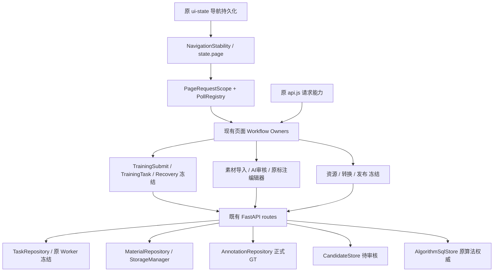

# 证据限定架构整改｜训练主链冻结

用户补充高于原附件：只修可复现缺陷，不因行数、window、Observer、兼容层或多模块进行重构。
基线42.24.557 / 08a3c2b02f52277339c226ff6ff961ce57a69f5f，远端一致、准确CI22/22成功。
隔离克隆D:/lab/yolosuanfa/aixunlianpingtai-review-20261106；用户WIP只读，生产/A800/4070不访问、不部署。

## 不变边界及基线

原MaterialRepository、AnnotationRepository、CandidateStore、NegativePool、TaskRepository、Worker、Provider、
请求/导航/缓存、转换与远程节点Owner保留。预设账号密码保持不变。
训练参数/默认值、首训/迭代、母模型、标签、划分、历史隔离、准入、快照、GPU/Worker状态机及版本归档冻结。
Git blob与app训练相关定义AST摘要记录在evidence/architecture-2026-11-07/frozen-training-baseline.json。
基线算法SQL/负样本45通过；训练lineage/label/split/precision/resource/snapshot133通过、1跳过。
负样本Node11通过、原Chrome4通过；ZIP125通过1跳过；远程启动/升级合同8通过。
上述均隔离测试，不是现场验证。测试有重叠，不加总。

## P0-1：已证明鉴权缺陷，现场使用未知，本轮不改

1. 实际链：app startup→旧maintenance→旧队列dispatcher→_v48_launch_saved_job→X-API-Key POST /api/remote/train；
   新Node Agent链独立存在，但不能证明旧链现场已退役。旧SH/BAT入口仍在，未找到systemd/Docker定义不能推出现场未部署。
2. 缺陷：remote_train_server.check_key为空时放行；config POST不校验，可清空已有key。
3. 隔离复现：临时目录设置key后无key GET=401，未授权config清空=200，同一GET=404，证明绕过认证。
   没有调用health/train/GPU/Worker，没有读生产配置或密钥。
4. 现有8项只保护启动/设备/升级合同，没有保护该认证场景。
5. 最小候选仅旧服务鉴权及受控bootstrap，须先有现场实际使用证据；按本轮约束不实施。
6. 影响：若真实可达，未授权客户端可改key并访问旧任务入口；未部署则仅潜在代码风险。不能声称公网已暴露或生产不受影响。
7. 风险：无key旧节点直接严格鉴权会断开旧任务/连接测试，不能静默升级，更不能改平台默认登录账号。
8. 非代码办法：现场以脱敏部署清单/进程/调用日志确认，旧任务迁完再评估退役；本轮不执行现场操作。

分类：已确认代码风险；无法现场验证；旧兼容链建议保留；训练执行未修改。

## P0-2：负样本算法范围查询的必要性八问

1. 当前：algorithm_scope调用list_algorithms→read_all整项目；listing再调用一次同链，仅选择单个算法。
   read_all原本已预取避免N+1，bootstrap_summary原本已轻量，不能把它们笼统判成错误实现。
2. 复现：真实SQLite+FastAPI路由，9算法、16版本、48MiB合成评测/契约，查询无版本的目标算法。
3. 测量：每次解析100,666,830字节/50次JSON，40次SQL；7样本P50=931.12ms，样本P95=1146.50ms。
   SQL累计和JSON耗时原始值见algorithm-before.json，来自原performance_diagnostics；不是生产测量。
4. 现有45项保护算法完整读写/迁移/事务、版本/外部映射及负样本行为；新增小范围重数据API回归先RED。
5. 最小方案：原AlgorithmSqlStore增加纯SQL存在性查询；负样本范围校验使用它，确需继承契约时复用原read_one完整对象。
   不新增数据库/投影缓存，不改read_all/read_one合同，不改任何训练调用或标签解析。
6. 不改：仅算法ID校验和一个空版本算法列表也重复读取约96MiB JSON，用户操作等待接近1秒，随项目体量增长。
7. 波及：仅负样本路由算法存在性及单目标选择；完整列表/详情、训练继承、外部映射/发布、版本指针与持久化不动。
8. 非代码：减少算法版本/评测会损失业务历史，不接受；让用户不使用算法筛选不能解决操作闭环。

请求/响应冻结：负样本GET参数、成员POST参数及成功/缺失算法状态码保持；同一合成输入响应摘要前后比较。
选中的算法对象必须与原read_all筛出对象深度相等，保留全部未知字段/版本/评测/契约/外部映射。

## 其他审计待汇总

负样本UI：证实单卡入口与菜单链不一致、201张被拒、迟到成功提示、回执统计不足；原跨页、全筛选、Observer、缓存与正式审核应保留。
ZIP：活跃v19扫描/提取及v36绕过统一限额；关闭的旧带标注路由HTTP409先拒绝，不重复开发。
app.py/app.js体积、函数覆盖、DOM装饰、CSS、异常捕获和兼容API先只审计；没有故障证据不改。

进度：P0-2本地验证完成、准备提交；P0-3/P0-4仅完成审计，尚未实施。

## 用户确认的远程服务边界

用户已明确确认：无法确定8020旧服务现场是否运行或有正式调用，本轮只读风险记录，暂不修改/删除旧服务、接口、鉴权或启动逻辑；其余P0独立推进。风险状态为“现场使用情况待确认”，不得自行升级为授权修复。

## P0-2 修复与验证结果

仅新增AlgorithmSqlStore.exists项目定向SQL；negative_pool_api原存在性校验改用它，原继承契约仍传入read_one完整对象。
没有新Schema、迁移、缓存或业务执行层；算法完整列表/详情、版本写入、当前指针、标签/继承与发布代码未动。
同一合成输入的JSON响应SHA256前后均为8a9d32694126c98cd0d926107ed16cabb57e1d024782d983396b5ca721b553aa。

| 7样本隔离指标 | 修改前 | 修改后 |
| --- | ---: | ---: |
| 请求P50 | 931.12ms | 33.52ms |
| 样本P95（最近秩） | 1146.50ms | 91.86ms |
| 每请求算法JSON字节 | 100,666,830 | 31 |
| JSON解析次数 | 50 | 1 |
| JSON解析中位耗时 | 105.63ms | 0.015ms |
| 整个API SQL次数 | 40 | 38 |
| SQL累计中位耗时 | 799.72ms | 14.17ms |

原始7样本及比较见evidence/architecture-2026-11-07/algorithm-{before,after,comparison}.json。
它证明“无版本目标的负样本列表不应解码其他算法报告”，不是生产P95或所有算法GET的性能结论。
选定有版本算法仍用既有完整read_one；不冒险裁剪其标签合同输入。完整详情字段、版本/未知扩展字段保持。

验证：算法SQL/负池/标签/继承87通过；相关算法/版本/外部映射与发布完整集合428通过；Node全量1558通过；
原目标负样本Chrome4/4通过（含窄屏、GT保护、原训练草稿及原ZIP入口，不启动真实训练）。
Windows默认长临时路径最初导致9个发布测试失败，其中一个使用基线08a原AlgorithmSqlStore源码也复现WinError3；
同一428项使用新建受控短临时目录全部通过。未更改发布逻辑、测试断言或系统长路径设置；现场影响未确认，保留独立环境风险。
68个冻结源码文件blob及63个app训练定义AST保持；账号密码、GPU/Worker、训练数学/参数与发布写入未修改。
CI复用Algorithm SQL Store原工作流加入负池读合同与合成重数据界限，不新增工作流或业务引擎。

## P1 静态架构审计：建议保留

这是当前代码接入与Owner文档映射，不是20条流程全部现场E2E。main.mjs的NavigationStability、PageRequestScope、PollRegistry继续作为唯一接入。
app.py基线AST有340个字面量路由注册，同method+path重复0；不把它冒充include_router运行时全量证明。
_detect_local_deploy_resource旧实现由alias保留，最终函数仅为Rockchip扩展，其余委托；_v40_run_component_scan旧扫描先到98%，最终层补RKNN后到100%。
没有重复执行故障证据，转换冻结，两者建议保留，不因重名拆分。
UI_BUILD_VERSION只有内部PlatformCore元数据与dataset.uiBuild消费者，现有version-marker-owner测试明确保护；不等于后端正式版本，不因数值不同修改。
素材/菜单Observer分别维护锚点关闭、尺寸与重绘后按钮，离页清理；分类字典缓存有TTL/失效职责，不能按“多处缓存”认定重复权威。

| 业务链 | 当前Owner/权威 | 本轮判断 |
| --- | --- | --- |
| 素材上传/ZIP | MaterialUpload/ZipImportRuntime→原导入任务/MaterialRepository | 原流程保留；活跃ZIP防护缺口另P0处理 |
| 查看筛选/图片详情 | MaterialPagination/MaterialPresentation→MaterialRepository | 549以来实现保留 |
| 单/批标注 | 原AnnotationWorkbench→AnnotationRepository | 权威冻结 |
| AI预标注/人工审核 | AutoLabelPollRuntime/原审核→TaskRepository/Provider/CandidateStore/GT | 已有能力保留 |
| 负样本池 | 原NegativePoolRuntime→原API/NegativePool同库 | 仅P0-3已证实缺口 |
| 标签管理 | 原label管理及映射→原标签合同 | 冻结 |
| 算法创建/版本管理 | AlgorithmListRuntime/原CRUD→AlgorithmSqlStore | 写入/指针/映射保留 |
| 基础模型 | 原模型资产入口→ModelArtifactRepository | 保留，未实测 |
| 训练创建/选材/资源/详情 | TrainingSubmit/Picker/原资源/Recovery→原任务及正式素材/标签 | 全面冻结，仅回归 |
| 转换/数值验证/场景实测 | 原Conversion/Quality/Scenario Owners→原产物/评测事实 | 保留/冻结，不做硬件探测 |
| 新畅联交付 | 原发布Owner→原OSS/映射/发布服务 | 保留；Windows长路径风险独立记录 |
| 存储与节点 | 原Source/Resource/节点Owner→原配置与调度 | 保留，不操作生产 |

## 当前UI普查（不实施全站视觉重写）

真实Chrome：15个实际页面Owner×1920/1366/768共45视图，0JS页面异常、0HTTP错误、0写请求、0水平越界。
已人工查看代表图；隔离空库下未证明必须调整整体布局。全部结构化记录、取消toast复现及6代表图见ui-survey证据子目录，
45张原截图仍在隔离test-results-architecture-survey。图片详情/基础模型子Tab/有模型转换及交付不是本次普查已验收交互，不冒充覆盖。

唯一清楚复现的P1：450ms读取延迟、160ms切页，13次__PAGE_NAVIGATION_CANCELLED__经旧safe()及resource-discovery.refreshCache的catch在新页toast。
两处已有取消识别helper可用于最小修正，但本轮按“其他架构先只审计”不改原导航/请求/资源Owner。
分类为“有问题，当前证明为提示噪声，未证明数据损坏”；保留复现证据，建议独立小批修复。
