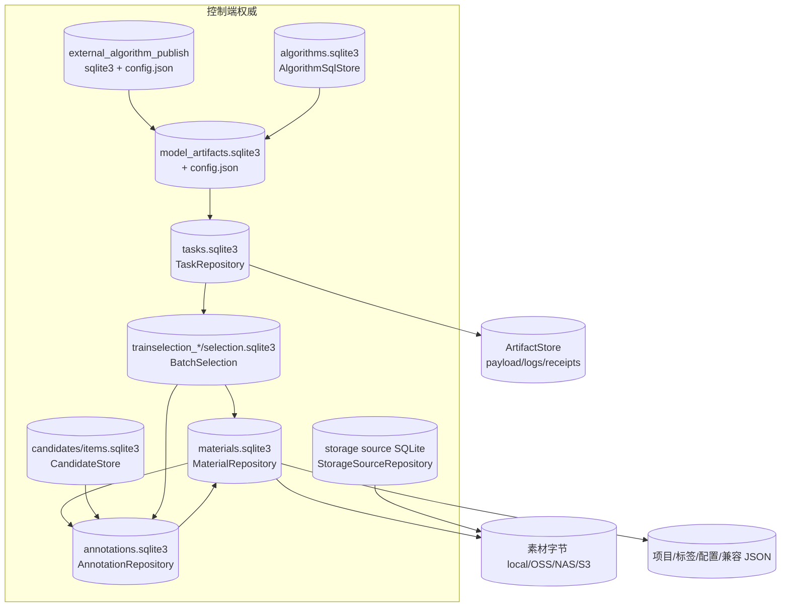

# F0 整体架构迁移盘点（只读基线，2026-11-22）

> 本文件是 F0 只读调查与迁移设计，**不实施** PostgreSQL 切换、GPU 调度器替换、存储重构或生产部署。
> 现有三份正式文档仍为事实来源，本文件只增量补充 F0 视角，不另立一套结论：
> - [PLATFORM_ARCHITECTURE_AUDIT_20261121.md](PLATFORM_ARCHITECTURE_AUDIT_20261121.md)
> - [PLATFORM_EVOLUTION_ROADMAP_20261121.md](PLATFORM_EVOLUTION_ROADMAP_20261121.md)
> - [P2_DATA_OWNERS_AND_POSTGRESQL_PREPARATION_20261117.md](P2_DATA_OWNERS_AND_POSTGRESQL_PREPARATION_20261117.md)
> - [DISTRIBUTED_WORKER_CLUSTER_ARCHITECTURE_2026_10_10.md](../DISTRIBUTED_WORKER_CLUSTER_ARCHITECTURE_2026_10_10.md)

## 0. 基线与证据口径

- 代码基线：`014c615a`（上传闭环整改前）；本轮整改提交在其上增量，F0 不改变业务数据。
- 已核对：Vue 路由/页面、`app.py` 341 条路由、`platform_core` 241 个 Python 文件、TaskRuntime/ArtifactStore、材料/GT/候选/算法/产物/发布 Owner、SQLite 与 `ATTACH` 读点、分布式 Worker 文档。
- 未核对：生产数据库实例、生产日志、真实 20 万数据分布、A800/4070、真实 NAS/OSS 延迟、真实多机网络分区。
- 证据状态：`EXISTING`（源码在运行路径）、`PARTIAL`（有实现但有已确认边界）、`NOT_IMPLEMENTED`、`NOT_VERIFIED`（无生产/现场证据）。**F0 不下“生产可用”结论。**

## 1. 现状架构与业务功能清单

### 1.1 进程与逻辑边界

- FastAPI 模块化单体：Web 进程加载 `app.py` + 已抽离 Router + `platform_core`；不是微服务、无消息总线。
- 执行面为独立进程：Scheduler / Worker / Node Agent / OS Supervisor，共享 `TaskRepository` 与 ArtifactStore；F1 锁域是同机文件锁（见审计 8.3）。
- 前端双运行时：旧 `static/app.js + main.mjs` 仍是默认完整入口；`/app/` 为 Vue 3 + TS + Vite + Router + Pinia + Element Plus 原生入口，未迁移页面显式回退旧工作台。
- 当前 `/app/` 有 11 条业务路由（算法库、素材库、图片上传、ZIP、上传任务、训练任务、训练创建、训练报告、版本报告、AI 候选审核、公共负样本池），另有 root/legacy/not-found。
- 数据面按域分 SQLite；跨域读通过 `ATTACH`（材料批量、rescan、选材 usage/GT）；跨域写不共享事务。

### 1.2 业务域清单

| 域 | 用户功能 | 唯一 Owner | 当前实现 |
|---|---|---|---|
| 项目/账号/标签/配置 | 登录、项目、标签、平台配置 | app 项目/标签函数、登录 Owner、SecretStore | `EXISTING`；JSON/配置与原子替换 |
| 素材 | 上传、ZIP 导入、浏览、筛选、详情、治理、删除索引 | `MaterialRepository` + `MaterialBatch` | 后端 `EXISTING`；Vue 图片/ZIP/删除/任务中心已原生接入，确认与治理有旧入口桥接 |
| 正式 GT | 人工标注、AI 候选确认、清洗后 GT | `AnnotationRepository` | `EXISTING`；GT 写仍为旧标注台/Candidate 提交 Owner |
| AI 候选/草稿/审核 | AI 预标注、候选审核、采用/拒绝 | `CandidateStore` | `EXISTING`；Vue 单图审核已迁移，批量/复杂审核桥接 |
| 清洗 | 质量扫描、清洗建议、任务 | `MATERIAL_BATCH/CLEAN` + Clean Owner | 后端 `EXISTING`；Vue 确认面板触发原 Owner，任务详情回旧入口 |
| 训练选材/冻结 | 分页筛选、跨页选择、冻结、Train/Val/Test | `BatchSelection` / `training_selection_reference` | 后端 `EXISTING`；Vue 创建/选材已迁移 |
| 训练任务 | 创建、停止、恢复校验、日志、报告 | `TaskRepository` + Training Handler | 后端 `EXISTING`；Vue 列表/详情/停止/恢复已迁移；暂停/提权/历史管理桥接 |
| 模型转换/交付/发布 | 转换、产物、版本、外部发布 | `ModelArtifactRepository` / `ExternalPublicationRepository` | 后端 `EXISTING`；Vue 部分只读，写操作桥接 |
| 服务节点/GPU | 节点注册、能力、资源、调度 | `service_nodes` / `task_node_assignments` / `gpu_resources` | `PARTIAL`，见第 4 节 |
| 证据/日志 | payload、日志、回执、不可变证据 | `ArtifactStore` | `EXISTING`；不迁入关系库 |

## 2. 能力矩阵（实现 / 部分 / 未实现 / 未验收）

| 业务链 | 后端 | 原生 Vue | 旧入口 | 定向测试 | 现场/规模 |
|---|---|---|---|---|---|
| 素材浏览/详情/选择 | `EXISTING` | 已迁移 | 保留 | `REAL_API_VERIFIED` | 20 万隔离有界；真实未验 |
| 图片上传 + request_id 恢复 | `EXISTING` | 已迁移（本轮） | 保留 | `REAL_API_VERIFIED` + 单元 | 生产未验 |
| ZIP 上传/分片/暂停/续传 | `EXISTING` | 已迁移（本轮） | 保留 | `REAL_API_VERIFIED`（多/暂停/重开） | 真实 NAS/OSS 未验 |
| ZIP 标签映射/导入 | `EXISTING` | 原 Owner DOM 宿主 | 保留 | `REAL_API_VERIFIED`（小 ZIP） | 大 ZIP/复杂映射未验 |
| 上传后确认/清洗/负样本/AI 入口 | `EXISTING` | 已接通 Owner，部分旧入口 | 保留 | `REAL_API_VERIFIED` | 生产未验 |
| 素材删除（v62 计划） | `EXISTING` | 已迁移 | 保留 | 101 真实；501/2001 协议模拟 | 真实 501+ 未演练 |
| 训练创建/选材/冻结 | `EXISTING` | 已迁移 | 保留 | 有 | 20k/30k 隔离；真实未验 |
| 训练任务停止/恢复 | `EXISTING` | 已迁移 | 保留 | Mock + 隔离 FastAPI | 真实 GPU 进程未验 |
| 训练暂停/提权/历史 | `EXISTING` | 未迁移 | 唯一入口 | 既有 | `NOT_VERIFIED` |
| 训练报告/评测 | `EXISTING` | 只读已迁移 | 决策写保留 | 有 | 生产未验 |
| 模型转换/交付/发布 | `EXISTING` | 部分只读 | 写入口保留 | 既有 | 外部服务未验 |
| 中央自动调度 | `PARTIAL` | 只读节点页 | 原入口 | 既有单元/隔离 | 多机未验 |
| 多 GPU 单机并行 | `PARTIAL` | 未原生 | 原入口 | 有分配单元测试 | 真实 Agent 未验 |
| 节点能力/资源硬准入 | `PARTIAL` | 只读 | 原入口 | 有部分测试 | 现场未验 |
| PostgreSQL | `NOT_IMPLEMENTED` | — | — | — | 未授权 |
| NAS/OSS 直达 Worker | `PARTIAL` | — | Bundle 路线 | 历史隔离 | 跨机未验 |

## 3. 数据库与存储迁移依赖图

强制依赖：

- `material_batches` 通过 `ATTACH` 读取 selection；`training_material_picker_api` 通过 `ATTACH` 读取 usage/GT；`MaterialRepository` rescan 通过 `ATTACH` 读取 manifest。
- PostgreSQL 不能直接翻译 `ATTACH`：同一事务所需的表必须进入同一目标数据库/Schema，经原 Repository 查询；不得改成跨库 HTTP 后假装强一致。
- Task、GT、冻结选择必须作为一个**授权单元**设计；不能只迁素材表就宣称“支持 PostgreSQL”。
- 大文件/权重/日志不进关系库；ArtifactStore 的不可变引用、SHA、payload 版本保留。
- SecretStore 不复制明文；StorageSource 只迁引用与类型配置。
- JSON 兼容镜像（`algorithms.json`、历史导入等）保留读取兼容，不升格为第二权威。

## 4. 多 GPU 节点调度缺口与资源预算

### 4.1 已有

- 节点启用/心跳/允许能力/上报能力、portable contract 过滤（`task_node_assignments.py`）。
- 中央 `CentralTaskAllocator.assign_next()`：优先级、GPU 选择、队列位置、分配评分。
- TaskRepository 的 lease/attempt/fencing、Worker instance 心跳。
- 单机双 GPU 预留的单元/隔离测试；远程训练、清洗、ZIP 的 Node Agent Runner。

### 4.2 已确认缺口

| 缺口 | 事实 | 风险 |
|---|---|---|
| 中央持续自动分配驱动 | 文档记载未在启动入口确认常驻自动分配闭环，仍存在手动 `allocate-next` 路径 | 任务可能等待人工/浏览器触发 |
| Agent 执行循环 | `NodeAgentExecutorLoop.run_once()` 为单任务执行循环 | 同一 Agent 不能同时跑训练 + CPU 清洗/ZIP，双 GPU 并行受限 |
| 硬资源准入 | 训练评分允许“繁忙但显存充裕”节点压过空闲小节点；清洗主要按空闲排序，未把全部非 GPU 任务剩余容量作为硬门槛 | 超卖/假忙/错误排队 |
| 多 GPU 任务 | 预留模型存在，但真实 Agent 的 GPU UUID 独占/集合、进程级隔离、并行领取未端到端验证 | 双任务抢同一 GPU / 映射错位 |
| 远程能力边界 | `AI_ANNOTATION`、`VIDEO_FRAMES`、标签 remap/audit 等未确认远程 Runner | 勾选能力 ≠ 可执行 |
| 自动唤醒 | 任务结束/取消/节点上线/资源释放的唤醒链路未证明 | 队列停滞 |

### 4.3 资源预算方案（设计，不实施）

节点上报（心跳，持久化到既有 worker instance/节点记录，不新建调度库）：

- `gpu_slots[]`：UUID、显存总量、当前任务占用、驱动/CUDA ready、MIG/共享策略。
- `cpu_cores_total/used`、`ram_bytes_total/used`、`scratch_bytes_total/used`、`data_mounts[]`。
- `capabilities_allowed/reported/ready` 三列分离；`running_tasks[]` 由 TaskRepository lease 推导。

任务需求（创建时冻结，随 Task payload）：

- `gpu_count`、`min_gpu_memory`、`cpu_cores`、`ram_bytes`、`scratch_bytes`、`portable_contract`、`storage_source`、`node_affinity`。
- 训练任务默认 1 GPU；多 GPU 任务必须在**同一节点**取 UUID 集合，不跨节点切分。
- 预算取值来自真实测量（模型+workers+dataloader 峰值、数据集解压+checkpoint 峰值），不编造固定阈值。

准入顺序：

1. 节点启用 + 心跳有效 + allowed∩reported + ready + portable/亲和/存储可达；
2. 真实剩余预算 ≥ 任务预算，且与 ASSIGNED/CLAIMED/RUNNING/CANCEL_REQUESTED/清理中/本机非平台进程合并计算；
3. 合格节点排名（可立即执行优先，再性能/本地性/公平性）；
4. 预留写入与 lease 绑定同一事务边界；失败可撤销；
5. 任务结束/取消/节点上线触发有界唤醒，不用浏览器轮询代替。

## 5. 性能热点与需要的测量证据

来自审计第 7 节（不重复造表）：

| 热点 | 现状证据 | 仍需测量 |
|---|---|---|
| H1 旧全量项目/数据集/素材接口 | 源码 `CONFIRMED` 无界读 | 生产是否触发、HAR/Server-Timing、P95 |
| H2 `MaterialRepository.read()` 全表 | 源码 `CONFIRMED` | 20 万真实 GT 下的耗时/内存 |
| H3 `mutate()` 写锁全表 | 源码 `CONFIRMED` | 真实批量划分/清空项目锁等待 |
| H4 精确 COUNT | 200k 隔离首页 1.155ms/深页 5.688ms | 真实筛选/并发写下的 P95 |
| H5 LIKE/json_extract 过滤 | 部分表达式索引 | 真实查询计划与选择性 |
| H6/H7 选材全池 usage/角色缓存 | `lru_cache`、10k/50k 夹具 | 20 万 + 真实历史内存/首查 |
| H8 深分页 OFFSET | 200k 元数据 5.7ms | 角色/GT EXISTS 深页 |
| H9 2 万冻结/提交 | 20k/30k 隔离 316–484ms | 真实图片/GT 端到端 |
| H10 缩略图 I/O | 冷路径多次整文件 SHA/解码 | OSS/NAS 延迟、并发、慢客户端锁 |
| H11 任务队列 N+1 | 100 任务 93.56→3.64ms（单端点） | 其他端点 |
| H12 删除预览物化整个选中集 | 源码 `CONFIRMED` | 10 万选中内存/时间 |
| H13 冻结 revision 过度失效 | 源码 `CONFIRMED` | 写频繁时失效频率与重建成本 |

测量纪律：同一快照/高水位、冷热分组、P50/P95/P99、样本量、错误率；不以隔离测试替代生产结论。

## 6. 分阶段迁移方案与安全退出条件

### F0（本轮，只读）

- 完成本盘点；不切库、不换调度、不迁存储。
- 退出：本文件与既有三份文档无冲突；Owner/依赖/缺口/测量清单可复核。

### F1｜后端 Router 与合同治理

- 新路由不再进 `app.py`；按域抽 Router，AST 等价 + 合同测试；不改状态机/锁域。
- 退出：路由唯一、原测试指向新注册端点全绿、无行为漂移。

### F2｜前端功能等价与旧入口收敛

- 按矩阵逐条迁移高频只读/写入口；每条保留旧回退，禁止“跳旧页冒充原生”。
- 退出：目标路由有真实入口测试；旧功能仍可用；未迁移项明确列出。

### F3｜读路径与性能治理

- 先测量 H1–H13；只对实测热点做分页/索引/投影/后台任务；不改筛选语义、不静默截断。
- 退出：前后对比、真实规模证据、回退方案；未达阈值不进入数据库迁移。

### F4｜存储与数据通路

- 先做 Bundle 路线稳定性；再评估 NAS/OSS 直达 Worker；SHA/Revision/split/缓存 GC 合同不变。
- 退出：跨机传输、断点、SHA 校验、失败关闭、缓存命中/孤儿回收证据；控制端不承担重计算。

### F5｜GPU 调度硬准入与多 GPU

- 中央常驻自动分配驱动；Agent 多执行槽/进程隔离；GPU UUID 集合硬预留；CPU/RAM/磁盘预算；唤醒闭环。
- 退出：混合能力矩阵、双 GPU 并行/第三排队、忙节点不超卖、lease 失效 fail-closed 的真实多机 UAT。

### F6｜单域 PostgreSQL 评估（仅评估）

- 仅在写竞争/多主机/跨域事务/百万级热表/备份恢复等有真实证据时启动；单域、无双写、先影子后切换。
- 退出（评估）：Owner/ATTACH/事务/CAS/回执/回退全部列清；未授权不得建驱动/DDL/双写。
- 切换退出（若未来授权）：一致性副本、只读影子、单写切换、对账、回退窗口、旧库只读退役。

### 明确禁止

- 未经授权切 PostgreSQL、替换调度器/存储、改 GT/任务/冻结 Owner。
- 以“数据变多”为由迁移；以迁移替代性能优化。
- 新建第二套上传/任务/素材/GT/Registry 数据库。
- 删除旧入口或生产数据。

## 7. 结论

- 当前是“单机强一致 + 文件锁 + 多进程 Worker”的模块化单体；Vue 是渐进入口，不是第二后端。
- 上传/删除/训练操作已具备真实隔离证据；仍缺生产规模、真实 GPU、多机调度和真实 501+ 删除演练。
- 迁移顺序必须是：合同/Owner → 前端等价 → 性能证据 → 存储 → GPU 调度 → 数据库评估；任一阶段无证据不得越级。
