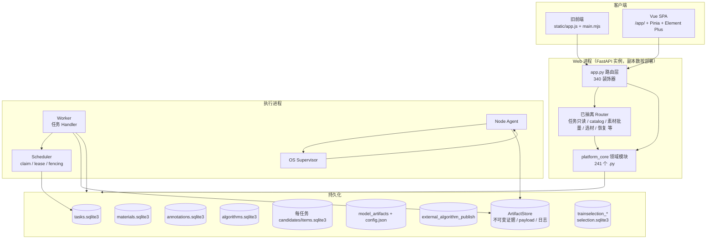

# 畅联云算法训练平台｜架构与性能深度审计（2026-11-21）

> 本文是 2026-11-21 架构改造的**总依据**：记录为什么改、现在是什么、哪里慢、哪里还不确定、以及各项技术决策的状态。
>
> **状态标识约定**（全文使用，不得混用）：
>
> | 标识 | 含义 |
> |---|---|
> | `EXISTING` | 代码中已存在并在运行的设计或实现，不是本轮新增建议 |
> | `PROPOSED` | 本轮审计建议，**未经用户签认**，不能当作已批准架构 |
> | `TBD` | 已识别问题，方案或合同尚未确定 |
> | `NOT VERIFIED` | 没有证据；不等于"没有问题"，也不等于"有问题" |
> | `CONFIRMED` | 有源码或可复核证据确认 |
>
> 配套文档：
> [20 万级素材性能验收规范](../performance/PLATFORM_SCALE_ACCEPTANCE_20261121.md)、
> [架构演进路线与阶段验收](PLATFORM_EVOLUTION_ROADMAP_20261121.md)。
> 既有台账：[功能保留](EXISTING_FEATURE_PRESERVATION.md)、
> [Vue 迁移矩阵](VUE_M0_FUNCTION_API_MATRIX_20261118.md)、
> [数据 Owner 与 PostgreSQL 准备](P2_DATA_OWNERS_AND_POSTGRESQL_PREPARATION_20261117.md)。

---

## 1. 文档范围与审计基线

### 1.1 基线

| 项 | 值 |
|---|---|
| 审计日期 | 2026-11-21（Asia/Shanghai） |
| 仓库 | `jorsamj/aixunlianpingtai` |
| 本地路径 | `C:\Users\jorsam\Documents\ChatGPT\算法相关\p2b2-backend` |
| 分支 | `feature/external-algorithm-publishing`（唯一开发分支） |
| 本地 HEAD | `1fa5119b84e8721e2dc4810903471a2e37b6e862` |
| 远端同分支 HEAD | `1fa5119b84e8721e2dc4810903471a2e37b6e862`（只读 `ls-remote` 核验，与本地一致） |
| 该 SHA 的 CI | 48 个 check-suite，未检索到 `failure` 结论；**只代表该 SHA 的已提交代码** |
| 代码量（源码统计） | `app.py` 29,653 行 / 340 处 `@app.<method>(` 装饰器 / 10 处 `include_router`；`platform_core` 241 个 `.py`、约 5.56 MB；`static/app.js` 1,417,893 字节 / 10,718 行；`frontend/src` 42 个 `.vue`；`tests` 435 个 `.py` |

### 1.2 本地未提交成果（必须保护）

本轮开始时工作区**不干净**，且这些成果**不属于**本次文档任务：

```text
 M app.py
 M platform_core/annotation_bulk_commit.py
 M platform_core/annotation_bulk_intents.py
 M platform_core/annotation_task_service.py
 M platform_core/task_runtime/fenced_repository.py
 M platform_core/task_runtime/repository.py
 M platform_core/task_runtime/scheduler.py
 M tests/api/test_ai_review_workbench.py
?? DSH_C2B_HANDOFF_20261121.md
?? docs/architecture/P2B_4A_2A_TASK_RUNTIME_ARCHITECTURE_AUDIT_20261118.md
?? docs/architecture/P2B_4A_2B_LOCAL_CLAIM_PIPELINE_20261118.md
?? docs/architecture/P2B_4A_2B_PAYLOAD_PUBLICATION_DESIGN_20261118.md
?? platform_core/annotation_bulk_execution.py
```

桌面另有 `C2B_DSH_REVIEW_V2.patch`（81,933 字节），本轮**未应用**。

这些文件是 **C2-B 的本地候选实现**，状态见第 8 节。任何架构结论都不能把它们的成果算作已交付。

### 1.3 已检查 / 未检查

**已检查（只读）**：`app.py` 路由与关键 handler、`platform_core` 素材/标注/候选/任务/选材/存储/产物模块、`frontend/src/app` 与 `frontend/src/views` 的路由与 API 调用、`static/app.js` 关键路径、`docs/` 历史性能与接续文档、GitHub Actions 只读元数据。

**未检查 / 未取得证据**：生产 A800 / 4070 环境、真实 20 万素材与真实 GT 分布、OSS/NAS 对象存储时延、真实浏览器 HAR 与 Long Task、真实 GPU 训练与模型转换、转换后硬件推理精度、多用户并发与 Worker 背景负载、生产 P50/P95/P99。

**因此**：本文所有性能数字均为**历史隔离测试**或**代码结构推导**，不是生产指标。凡标 `NOT VERIFIED` 的结论，不得在对外材料中改写为已验证。

---

## 2. 平台业务定位

畅联云不是图片标注工具，而是**视觉算法生产平台**。完整业务链：

```text
素材接入 → 数据治理 → AI 自动标注 → 人工审核 → 正式 GT
       → 数据集/划分 → 训练 → 评估 → 模型版本 → 转换 → 异构硬件部署与验证
```

这条链在代码中由 14 种任务类型承载（`platform_core/task_runtime/models.py:21-35`）。**任务类型数量不等于业务链数量**：一条业务链可能由多种任务组成（例如"素材接入"含导入与批量治理），同一任务也可能服务多个业务动作。

| TaskKind | 业务含义 |
|---|---|
| `RESOURCE_DISCOVERY` | 资源/环境发现 |
| `MATERIAL_IMPORT` | 素材导入（ZIP、存储扫描） |
| `MATERIAL_BATCH` | 素材批量治理（清洗、删除、标签） |
| `CLEANING` | 数据清洗 |
| `AI_ANNOTATION` | AI 自动标注 / 候选生成 |
| `ANNOTATION_FORMAL_BULK` | 审核后正式 GT 批量入库 |
| `VIDEO_FRAMES` | 视频切帧入素材库 |
| `TRAINING_PREPARE` | 训练准备（冻结、体检、打包） |
| `TRAINING` | GPU 训练 |
| `MODEL_CONVERSION` | PT → ONNX → 厂商模型 |
| `MODEL_INSTALL` | 模型安装到节点 |
| `DEPLOYMENT_TEST` | 部署与硬件验证 |
| `DEPLOYMENT_PREPARE` | 部署准备 |
| `EXTERNAL_ALGORITHM_CLEANUP` | 外部算法退役清理 |

**架构含义**：任何"页面重构"都不能切断任务、GT、版本、产物与证据链。这也是本审计拒绝"重写后端/重建数据层"的根本原因——代价不在 UI，而在这 14 种任务类型构成的执行链。

---

## 3. 为什么要进行架构改造

改造动机必须来自真实压力，不是"技术栈旧"。以下分五类，并标注证据等级。

### 3.1 业务规模

| 维度 | 规模 | 代码/文档依据 |
|---|---|---|
| 素材 | 20 万级 | `docs/MATERIAL_200K_PERFORMANCE_FIELD_ACCEPTANCE.md` 目标；历史隔离测试 200,000 条 |
| 算法 | 约 110 | 历史文档与 bootstrap 快照规模记录 |
| 算法版本 | 约 1,100 | 同上 |
| 历史任务 | 约 1,000 | 历史性能测试夹具（220/1000/10k） |
| 单次训练选材 | 2 万张以上 | 选材冻结引用用例 22,015 张；冻结清单上限 1,000,000 张（`training_selection_reference.py:11-12`） |
| 单次正式 GT 入库 | 50,000 张上限 | 不可变意图上限；`app.py` 注解选择接口 `image_ids` 上限 50,000 |
| 单次显式批量选择 | 100,000 张上限 | `material_selection.py` 的 `MAX_EXPLICIT_MATERIAL_IDS` |

规模不是假设，已经写进接口上限和测试夹具。

### 3.2 历史性能问题

历史反馈（隔离证据 + 用户现场观测）包括：素材库打开慢、训练选材器卡顿、跨页选择丢失、选择成功后训练创建页显示 0 张、重复统计与全量读取、批量操作长时间等待、页面与任务状态不准确。

**证据等级必须分开**：

- **有隔离测量**：选材器首页/深页/筛选、20k/30k 冻结链路、稀疏 GT 筛选、任务只读列表——数值见第 7 节与[验收规范](../performance/PLATFORM_SCALE_ACCEPTANCE_20261121.md)。
- **只有用户现场观测**：真实 20 万素材首屏、OSS/NAS 时延、多用户并发、浏览器 Long Task——`NOT VERIFIED`。
- **有代码路径但未证生产触发**：旧项目/数据集/素材全量接口、缩略图冷路径——见 7.3，措辞为"已发现代码级无界读取风险，实际生产触发范围和耗时尚待验证"。

### 3.3 代码耦合

- `app.py` 29,653 行、340 个路由装饰器，仅 10 处 `include_router`；路由、业务分支、缓存、启动生命周期混在一个模块。
- `static/app.js` 1.42 MB 单文件，页面状态、请求、渲染、交互混在全局 `state` 与 `window.*` 函数上。
- 旧前端 `loadRelated()` 一次并发拉取项目、数据集、素材、标签、算法、待发布、测试模型等接口（`static/app.js` 中的 `loadRelated`），其中多个是 O(N)。
- 文档体系同时存在 `AGENTS.md`（1,309 行 / 255KB）、`codex-handoff.md`（412KB）、`CODEX_CURRENT_STATE.md`（381KB）、`PROJECT_HANDOFF_CURRENT.md`（247KB），且互相有矛盾。

### 3.4 数据一致性

平台最贵的三类错误：

1. **素材身份错**：把路径当身份、把 SHA 当图片 ID。
2. **正式 GT 错**：候选草稿被当成正式 GT，或未写入却报告成功。
3. **冻结输入错**：训练用了已变化或未冻结的素材/标签。

现有代码已经为这三类错误建立了机制（第 5 节），改造不能弱化它们。

### 3.5 长期扩展

需要为多节点调度、异构 GPU、国产芯片、行业算法和未来视觉大模型保留扩展空间。这属于**架构预留**，不是本轮开发目标；本轮不训练领域大模型。

### 3.6 改造目标（一句话）

> 改造的是**有界性、唯一权威、可恢复性、功能等价**，不是技术栈本身。

---

## 4. 当前真实技术架构

### 4.1 逻辑与进程（C4 Container 视角）

必须区分**逻辑模块**、**实际进程**、**数据存储**与**执行控制**。下图中的 Python 模块**不是**独立部署的微服务。



**读法**：

- 本图是**逻辑视图**：`Web` 只是逻辑容器，**不代表实际部署副本数**（单进程或多进程/多实例均未在此断言，需以部署证据为准）；`platform_core` 是同一进程内的 Python 包，不是独立服务。
- `Worker` 与 `Agent` 是独立进程，但通过同一 `TaskRepository` 与文件锁协调（F1 的边界是**同机文件锁**，见 8.3）。
- SQLite 按域分库，跨域读通过 `ATTACH`（素材批量、rescan、选材 usage/GT 三处），跨域写不共享事务。

### 4.2 组件清单

| 层 | 组件 | 职责 | 位置 |
|---|---|---|---|
| 前端（旧） | `static/app.js` + `static/main.mjs` + `modules/*` | 默认入口，全部旧业务 | `static/` |
| 前端（新） | Vue 3 + TS + Vite + Router + Pinia + Element Plus | 8 条具名原生业务路由，复用 7 个独立页面组件（`training-report` 与 `version-report` 共用 `NativeTrainingReport.vue`） | `frontend/src/app/` |
| 前端（试点） | 18 个 `views/*.vue` | opt-in `?vue_*=1`，由旧运行时挂载 | `frontend/src/views/` |
| API | FastAPI 路由 + 已抽离 Router | HTTP、Session、项目校验、错误映射 | `app.py`、`platform_core/*_api.py` |
| 领域 | Repository / Service | 素材、标注、候选、算法、任务、产物、发布、负样本池 | `platform_core/*.py` |
| 存储 | `StorageManager` + Provider（local/OSS/S3/HTTP） | 素材字节与元数据 | `platform_core/storage/` |
| 证据 | `ArtifactStore` | 不可变 payload、日志、收据 | `platform_core/task_runtime/artifacts.py` |
| 执行 | `TaskRepository` / `Scheduler` / `WorkerContext` / `FencedTaskRepository` | 领取、租约、attempt、fencing、终态 | `platform_core/task_runtime/` |
| 节点 | `node_agent*.py` / `os_supervisor_*.py` | 远程执行与受控进程 | 仓库根 + `platform_core/` |
| 产物 | `ModelArtifactRepository` | 模型文件、转换产物、存储状态 | `platform_core/model_artifacts.py` |

### 4.3 明确边界

- **不是微服务**：没有独立服务发现、独立数据库实例、跨进程 RPC 业务边界。
- **不是事件驱动架构**：任务状态以 SQLite 行为准，`ArtifactStore` 存证据，没有消息总线。
- **不是多租户 SaaS**：项目是业务分组；生产按 canonical 项目暴露，跨项目访问默认 fail-closed。
- **执行权分离**：Vue 只读写同源 API，不取得执行权；Worker 只通过 `TaskRepository` 领取。

---

## 5. 业务数据唯一 Owner

### 5.1 正式 Owner（`EXISTING`）

| 数据域 | 唯一写 Owner | 存储 | 身份与幂等 |
|---|---|---|---|
| 素材 | `MaterialRepository` | 项目 `materials.sqlite3` | `image_id` + 项目；`material_meta.revision`；批处理回执 |
| 正式 GT | `AnnotationRepository` | `annotations.sqlite3` | `project + image_id`；`expected_version` CAS；`AnnotationConflictError` |
| AI 候选/草稿/审核日志 | `CandidateStore` | 每任务 `candidates/items.sqlite3` | `task_id + image_id`；`review_revision` / `draft_revision`；提交回执 |
| 训练使用历史 | `TrainingMaterialUsage` | 任务库旁 `usage` 索引 | `(project, algorithm, image_id, role)`；token 索引 |
| 算法与版本 | `AlgorithmSqlStore` | `algorithms.sqlite3` | `algorithm_id` / `version_id`；`algorithm_revision` |
| 执行任务 | `TaskRepository` | `task_runtime/tasks.sqlite3` | `task_id`；`lease_token` / `attempt`。**执行代数复用 `attempt`，表中没有独立的 `generation` 列**（`preparation_execution_generation` 只是部分接口的传参/围栏语义，不是持久列） |
| 模型产物 | `ModelArtifactRepository` | `model_artifacts/artifacts.sqlite3` + `config.json` | `artifact_id` + `sha256` + `conversion_job_id` |
| 外部发布 | `ExternalPublicationRepository` | `external_algorithm_publish/publications.sqlite3` | `publication_key` / `mapping_id`；UNKNOWN 回执 |
| 负样本池 | `NegativePool` | 复用素材库 | `(material_id, algorithm_id)`；`negative_pool_meta.revision` |
| 冻结选择 | `BatchSelection` + `training_selection_reference.py` | `task_runtime/artifacts/trainselection_*/selection.sqlite3` | `reference` + 上下文摘要 + `.freeze.lock` |
| 不可变执行证据 | `ArtifactStore` | `task_runtime/artifacts/<task_id>/` | 内容寻址 `sha256-<digest>`；payload 版本发布 |

详细合同见 [P2 数据 Owner 与 PostgreSQL 准备](P2_DATA_OWNERS_AND_POSTGRESQL_PREPARATION_20261117.md)。

### 5.2 派生投影（不是第二事实源）

| 投影 | 派生自 | 更新方式 | 风险 |
|---|---|---|---|
| `materials.payload_json` 中的 `annotation_state / box_count / labels / annotation_hash` | 正式 GT | GT 写入后投影 + 后台索引 | 投影滞后会让列表筛选不准 |
| `material_labels` / `material_annotation_scopes` | 素材标签与 GT 范围 | 素材/GT 事务内维护 | 与 GT 事务边界需一致 |
| `annotation_label_references` | 正式 GT | GT 写入同事务 | 若不同事务，训练资格会读到旧证据 |
| `training_usage_tokens` | 训练使用历史 | 使用记录同事务 | token 滞后会导致"未使用"误判 |
| `algorithms.json` | SQL Owner | 兼容镜像 | 不能当第二权威 |
| `conversion_history` | 转换任务 | 投影 | 不升格为写真相 |

**要求**：投影必须能重建、能对账、能检测漂移；**不得**新建第二套素材库/标注库/任务库。

### 5.3 缓存与前端状态

- 进程内缓存（`lru_cache`、revision 键有序字典）：不是事实源，必须能被 revision 失效。
- 浏览器 `sessionStorage` / `localStorage`：只保存展示态、草稿、待核回执，不是准入凭据。
- 任何"缓存替代正式 GT"的方案一律不采纳。

---

## 6. 当前架构改造成果

状态必须分别体现六个维度，**不能统一写"已完成"**：后端是否有功能、Vue 是否原生、是否仍用旧入口、是否有定向测试、当前 HEAD 的 CI 状态与覆盖、是否现场验收。

**CI 列口径**（详见 6.3）：`HEAD 绿` = 当前 HEAD `1fa5119b` 的 48 项 check-suite 已成功；`覆盖待核` = 该功能是否有对应 workflow/job 实际执行与断言，尚未逐项核对；`无 CI（未提交）` = 代码尚未进入任何提交。

| 业务链 | 后端能力 | 原生 Vue | 旧入口 | 定向测试 | 当前 HEAD CI / 覆盖 | 现场验收 |
|---|---|---|---|---|---|---|
| 算法库卡片/版本/备注 | `EXISTING` | 已迁移（列表/详情/备注写） | 保留（删除/回退/报告/转换/交付为桥接） | 有 | `HEAD 绿`；覆盖待核 | `NOT VERIFIED` |
| 素材库浏览/详情/使用记录 | `EXISTING` | 已迁移（只读 + 选择） | 保留 | 有 | `HEAD 绿`；覆盖待核 | `NOT VERIFIED` |
| 素材写入（上传/ZIP/标注/清洗/治理/删除审核） | `EXISTING` | 未迁移 | 唯一入口 | 有（旧合同） | `HEAD 绿`；旧合同覆盖 | `NOT VERIFIED` |
| 负样本池（算法级 v1 / 项目 v2） | `EXISTING` | 项目池已迁移；算法池为试点 | 保留 | 有 | `HEAD 绿`；覆盖待核 | `NOT VERIFIED` |
| 训练创建/选材/冻结 | `EXISTING` | 已迁移（普通创建） | 保留 | 有 | `HEAD 绿`；覆盖待核 | `NOT VERIFIED` |
| 训练任务列表/详情/日志 | `EXISTING` | 已迁移（只读） | 停止/恢复/暂停/提权/历史管理 | 有 | `HEAD 绿`；覆盖待核 | `NOT VERIFIED` |
| 训练报告/独立评测 | `EXISTING` | 已迁移（只读） | 决策写操作、复杂叠加 | 有 | `HEAD 绿`；覆盖待核 | `NOT VERIFIED` |
| AI 单图草稿/采用/拒绝 | `EXISTING` | 已迁移 | 保留 | 有 | `HEAD 绿`；覆盖待核 | `NOT VERIFIED` |
| AI 跨页选择/冻结 | `EXISTING` | 已迁移 | 保留 | 有 | `HEAD 绿`；覆盖待核 | `NOT VERIFIED` |
| AI 批量正式 GT（C2-B） | 本地候选实现（未提交） | 未迁移 | 旧工作台承接 | 有（含缺陷） | `无 CI（未提交）` | `NOT VERIFIED` |
| 模型转换/交付/部署 | `EXISTING` | 只读/壳 | 唯一执行入口 | 有（隔离） | `HEAD 绿`；真实硬件分支覆盖待核 | `NOT VERIFIED`（真实硬件） |

### 6.1 三种"已实现"必须区分

1. **后端业务已存在**：例如训练停止、转换、发布、批量治理。
2. **原生 Vue 已迁移**：例如算法卡片、训练创建、AI 单图决定。
3. **仅旧入口可用**：例如素材写操作、模型交付执行。

**不得**因为旧工作台未原生化，就把对应业务写成"未实现"；**也不得**因为 Vue 页面存在，就写成"整体完成"。

### 6.2 口径

- **没有任何一项被标为 `ACCEPTED`**。历史阶段记录中的 `FUNCTIONAL_COMPLETE` + `CI_PENDING` 是**阶段快照**，不是当前 HEAD 的 CI 状态。
- 本地定向测试通过 ≠ CI 通过 ≠ 该功能被 CI 实际覆盖 ≠ 现场验收。四者不得互相替代。

### 6.3 CI 状态分层

| 层次 | 当前事实 | 能推出什么 | 不能推出什么 |
|---|---|---|---|
| 当前 HEAD 的 CI | `1fa5119b` 的 48 项 check-suite 已成功 | 该提交能通过现有 workflow | 每项业务功能都有对应测试 |
| 功能覆盖 | 由各 workflow 的 job 与断言决定，需逐项核对 | 某功能是否被实际执行与断言 | 该功能在生产数据下正确 |
| 历史阶段记录 | 各阶段交付消息中的 `CI_PENDING` / 成功是当时 SHA 的快照 | 当时状态 | 当前 HEAD 状态 |
| 本地未提交 C2-B | 无任何 CI | — | 任何"已验证"结论 |
| 现场 / 生产验收 | 未进行 | — | — |

**结论**：不能因为"整个 HEAD 通过 CI"就推导"每项业务已验收"；也不能因为历史阶段记录写 `CI_PENDING` 就推断当前 HEAD 失败。两者都必须按上表分层表述。

---

## 7. 性能与可扩展性审计

### 7.1 方法与证据等级

本节的成本判断来自：源码调用链、SQL 原文、索引定义、历史隔离测试。**没有**生产观测，因此：

- 「已确认可达」= 有明确 HTTP 入口或后台路径。
- 「潜在风险」= 代码存在但未证明在关键用户路径上。
- 「已有优化」= 代码中存在缓存/索引/降级。
- 「生产未证明」= 缺真实数据与 HAR。

### 7.2 热点总表

| # | 热点 | 入口 | 成本因子 | 已有保护 | 证据 | 等级 |
|---|---|---|---|---|---|---|
| H1 | 旧项目/数据集/素材全量接口 | `GET /api/projects/{pid}`、`/datasets`、`/images`、`/annotation-index/status` | 素材行数 N | 无分页、无投影 | 源码 `CONFIRMED`；生产触发 `NOT VERIFIED` | P1 → 见 7.3.1 |
| H2 | `MaterialRepository.read()` 全表读 | `load_images()` 间接调用 | N | 无 | 源码 `CONFIRMED` | P1 |
| H3 | `MaterialRepository.mutate()` 写锁内全表处理 | 批量划分、自动划分、清空项目 | N，且持 `BEGIN IMMEDIATE` | 只写变更行 | 源码 `CONFIRMED` | P1 |
| H4 | 精确 `COUNT(*)` 阻塞首屏 | v61 素材列表、批量预览 | 行数 × 缓存失效率 | revision 键 LRU 128 | 源码 `CONFIRMED`；200k 隔离测过 | P2 |
| H5 | 关键词 `LIKE '%kw%'` + `json_extract` 过滤 | 素材列表/选材 | N 全扫（无索引谓词） | 部分 `json_extract` 表达式索引 | 源码 + `EXPLAIN` 记录 | P2 |
| H6 | 选材全池 usage 水合 | `_cached_usage_pool` | N + 历史 token 量 | `lru_cache(4)`、revision 键 | 源码 `CONFIRMED` | P1 |
| H7 | 选材全池角色索引 | `_cached_role_index` | N × JSON 解析 | `lru_cache(8)`、deferred 分页 | 源码 `CONFIRMED`；10k/50k 夹具 | P1 |
| H8 | 深分页 `OFFSET` | 选材 `/page`（前端传 `page`） | 页码 × 页大小 | `next_cursor` 已返回但前端未用 | 源码 `CONFIRMED`；200k 深页 5.7ms | P1（角色路径更高） |
| H9 | 2 万张冻结 + 提交 | `/selection-reference`、`/train/start` | 选中数 K | 冻结清单、幂等 request_id | 源码 + 20k/30k 链路测试 | P1 |
| H10 | 缩略图冷路径 I/O 放大 | `/materials/{id}/content/thumbnail` | 首屏卡片数 × 原图字节 | ETag/304、80MP 上限、内容寻址 | 源码 `CONFIRMED` | P1 |
| H11 | 任务列表队列位置 N+1 | 任务列表投影 | 队列任务数 × 候选查询 | 已新增批量位置读取（部分端点） | 源码 + 隔离测量 | P2 |
| H12 | 删除预览物化整个选中集 | 批量治理预览 | 选中数（全选时 = N） | revision/GT/标签三重校验 | 源码 `CONFIRMED` | P1 |
| H13 | 冻结选择过度失效 | 5 个全局 revision | 任一 GT/历史写即失效 | fail-closed | 源码 `CONFIRMED` | P1（可用性） |

### 7.3 逐项说明

#### 7.3.1 旧全量接口：**已发现代码级无界读取风险，生产触发范围与耗时尚待验证**

- `read_project()`（`app.py:4885`）读取全部素材，并对每张图调用一次 `read_annotation()`。
- `list_datasets()`（`app.py:4010`）读取全部素材，再分批读取全部素材的正式 GT，做数据集统计。
- `list_images()`（`app.py:5400`）读取全部素材，逐图 `stat()`，缺 `size_bytes` 时收集并回写。
- `v52_annotation_index_status()`（`app.py:5438`）为计算 pending 数量读取全部素材。
- `load_images()`（`app.py:1970`）就是 `MaterialRepository.read().rows`。

**为什么不能直接说"这就是卡顿根因"**：

- 素材库本身已改为 v61 服务端分页（前端 `material-pagination-runtime.js` 的 `FULL_MATERIAL_PAGES` 为空集，全量池只在显式动作时加载）。
- 这些旧接口是否仍在关键用户动作上被触发，取决于生产实际入口（旧 `/` 还是新 `/app/`）、页面与动作序列。
- 没有 HAR/Server-Timing，无法区分"前端反复请求"与"单次请求慢"。

**结论**：`CONFIRMED` 代码级无界读；**生产触发与耗时 `NOT VERIFIED`**。阶段 B 的核心任务就是核验它。

#### 7.3.2 `read()` 与 `mutate()`

- `read()`：`SELECT payload_json FROM materials ORDER BY created_at, id`，无 `LIMIT`，全表反序列化（`material_repository.py:626`）。
- `mutate()`：`BEGIN IMMEDIATE` 内全表 `SELECT`、全表归一化、逐行比较、逐行写回（`material_repository.py:1737`）。虽只落变更行，但**读、解析、比较全在全表范围**，写锁全程持有。

调用者包括批量划分的 filtered/dataset 分支、自动划分、清空项目。20 万行时是一次"全表 JSON 解析 + 写锁"，会阻塞其他写入。

**方向（`PROPOSED`）**：切到已有的 `mutate_ids` / `patch_filtered` 定点路径（`material_repository.py:1684`、`material_repository_batch.py`），保留语义。

#### 7.3.3 精确计数与缓存

- `list_page()` 在同一读事务内先 `_count_filtered_snapshot()` 再取页（`material_repository.py:1143`）。
- 计数缓存键包含库路径、`st_dev/st_ino`、material revision、归一化子句与参数；LRU 128（`material_repository.py:1067`）。
- 任何写入 `_bump_revision` 都会让计数缓存失效；批量任务期间每个列表请求都会重算。

200k 隔离测试：首页 P95 1.155ms、深页 5.688ms、来源+标签首查 40.817ms、文件名首查 18.057ms（前轮同量级）。**这只证明 SQLite 计数不是灾难，不证明生产首屏。**

#### 7.3.4 无索引谓词

`_filters()`（`material_repository.py:972`）是唯一权威谓词。其中：

- `m.filename LIKE '%kw%' COLLATE NOCASE`：前导通配符，普通 B-tree 索引无法使用；无 FTS5。
- `COALESCE(json_extract(payload_json,'$.split'),'unassigned')`：表达式 + COALESCE，无法命中索引。
- GT 状态三路 `COALESCE(json_extract(...))`：同上。
- `annotated`、`quality_status`：无专用索引。

已有索引覆盖：来源、状态、时间、内容 SHA、导入批次、删除占用、标签、标注范围。**缺失**：split、annotation_state、annotated、quality_status。

**方向（`PROPOSED`）**：先按真实查询计划决定是否建表达式索引/FTS5；索引构建有写放大，必须先量测收益。

#### 7.3.5 选材器的真实成本位置

第一页已经很好：前端每页 40 条、`count_mode='deferred'`、SQL 反连接、稀疏单标签有专门驱动。真正贵的是：

- `_cached_usage_pool`（`training_material_picker_api.py:140`）：全池 `processing_status='processed'` 扫描，500 行一批调用 `query_filter`，结果常驻内存，`lru_cache(4)`。
- `_cached_role_index`（`training_material_picker_api.py:1091`）：全池 `materials LEFT JOIN annotations`，逐行 3 次 `json.loads` + 角色分类，`lru_cache(8)`；命中缓存后仍每次重算 counts。
- `_role_material_page` 的 deferred 流式分块（`training_material_picker_api.py:1192`）：按 120 条一块前向扫描直到凑满目标页，**没有全局扫描预算**。

**关于稀疏类别的纠正**：不得用"扫描预算超限就拒绝"来解决。平台必须支持罕见类别、正负样本和长尾筛选。**允许的方向**：索引、查询计划、有界游标、服务端持续处理（后台继续计算并返回进度），且**不得改变真实筛选结果语义**。任何降级都必须显式告知"结果尚未完整"，不能静默截断。

#### 7.3.6 深分页

服务端支持 `cursor` 与 `page` 两种模式；`next_cursor` 已返回，但 Vue 选材页仍传 `page`（`TrainingMaterials.vue` 的 `load()`），因此走 `OFFSET`。`count_mode='deferred'` 时没有 `total_pages` 上界检查。

200k 隔离深页 5.688ms 是"元数据深页"，不含 GT EXISTS 与历史反连接；**角色筛选的深页未在 200k 下测过**。

#### 7.3.7 冻结选择

- `freeze_selection()` 把服务端枚举出的**每一个 id** 写入 `selection(image_id)`（`training_selection_reference.py:120`），筛选条件只作为 `request_scope` 字符串保存，不可重放。
- 写入在单事务内完成：K 次 INSERT + `COUNT(*)` + 全量有序回读算 `sha256` + 两条 meta + 页数配额；提交后 `wal_checkpoint(TRUNCATE)`。
- 上限：1,000,000 条 / 512MB；引用配额默认 128；磁盘预留 512MiB。
- 提交时 `read_selection()` 把 K 个 id 展开回 payload；prepare 阶段历史准入对整份 split 跑两次 `query_filter`。

20k/30k 链路隔离测试：冻结 316.575/369.156ms，汇总 126.306/184.237ms，创建任务 414.364/483.835ms，Worker 校验 22.100/30.860ms。**这是隔离元数据，不是真实 GT/图片。**

#### 7.3.8 缩略图 I/O

冷路径可能对同一原图做**三次整文件 SHA256**（`storage/local.py:140` 的 `_metadata`、`storage/cache.py:518`、`:526`）+ 一次全图解码 + 一次输出哈希。命中路径每次仍对缓存 JPEG 校验整文件 SHA，且 `FileLock` 持有到流式响应结束（`storage/cache.py:491`），慢客户端会串行化同图请求。

**纠正**：不得把 `size + mtime` 直接作为替代 SHA256 的正式方案——这会改变内容完整性保证。**候选方案（`PROPOSED`，需验证）**：在同一请求内复用首次哈希、把校验降为"一次全文 + 元数据一致性"，或将哈希移到写入侧缓存；必须验证内容身份、安全要求与实际收益。

#### 7.3.9 任务列表

`task_to_public()` 对每个 QUEUED 任务查询队列位置；非 TRAINING 还会触发额外精确性判定（`task_runtime/public.py:18`）。`queued_candidates()` 无 `LIMIT`（`task_runtime/repository.py:788`）。已在某端点引入批量位置读取，实测 93.56ms → 3.64ms（隔离 100 任务）。**其他端点是否仍走 N+1，`NOT VERIFIED`。**

### 7.4 已完成的优化（不要重复做）

| 优化 | 位置 | 效果 |
|---|---|---|
| v61 服务端分页 + keyset 游标 | `material_repository.list_page` | 首页/深页有界 |
| 窄列优先的两段式页 SQL | `_deferred_material_page_sql` | 避免宽行早期物化 |
| 状态计数单次聚合 + revision 缓存 | `processing_status_counts` | 替代多次 page_size=1 |
| 过滤计数 revision 缓存 | `_count_filtered_snapshot` | 避免重复 COUNT |
| 稀疏单标签 GT-first 驱动 | `_sparse_positive_gt_label` | 43.451ms → 3.157ms（隔离 200k） |
| 选材 deferred 计数与角色 | `count_mode='deferred'`、`defer_role_counts` | 不在首屏做全池统计 |
| 批量选择哨兵行替代 COUNT | `_bulk_filtered_ids` | 避免二次全扫 |
| GT 汇总临时表 + 双索引 | `training_ground_truth_summary` | 支持 1 万～10 万 id |
| 训练使用 token 索引 | `training_material_usage` | 200 项 OR 查询 30.33ms → 0.42ms（隔离） |
| 任务列表批量队列位置 | `resource_queue_positions` | 100 任务端点 93.56ms → 3.64ms（隔离） |
| 缩略图内容寻址 + ETag | `MaterialCache` | 暖态零新增请求 |
| 启动快照复用 | `_V53_BOOTSTRAP_SNAPSHOT` + tab 级 sessionStorage | F5 先绘制后核验 |

### 7.5 尚未证明的部分

- 真实 20 万素材 + 真实 GT 分布的首页/深页/筛选。
- OSS/NAS 时延对缩略图与详情的影响。
- 浏览器 Long Task、解码、主线程卡顿。
- 多用户并发与 Worker 背景写入对读路径的影响。
- 2 万张冻结/提交在真实图片与真实历史下的端到端耗时。
- 生产 P50/P95/P99、错误率、超时率。

**这些必须由[验收规范](../performance/PLATFORM_SCALE_ACCEPTANCE_20261121.md)的场景与口径来判定，不能用本文替代。**

---

## 8. C2-B 安全与可靠性

C2-B 指"冻结选择后的后台分批正式 GT 入库"。当前状态：**本地候选实现，未提交、未 CI、未验收**。

### 8.1 已完成主干（`CONFIRMED`，代码在工作区）

| 合同 | 实现 | 位置 |
|---|---|---|
| 唯一执行任务 | 由 C1 `operation_id` 派生稳定 `fbulk-` task_id | `annotation_bulk_execution.py` 的 `execution_task_id()` |
| 不可变绑定 | 绑定写在自己的 Artifact 命名空间，含 actor/project/original task/request/manifest | `build_binding()` / `validate_binding()` |
| 执行 / 查询 / 取消 API | POST execute、GET execution、POST cancel | `app.py` 的 `execute_bulk_formal_intent` 等 |
| CPU Handler | 注册 `ANNOTATION_FORMAL_BULK`，无 GPU 能力 | `annotation_task_service.worker_registration()` |
| 100 张续批 | 循环消费封存清单，逐批验证前置证据 | `run_formal_bulk()` |
| 取消对账 | 只补候选日志，不新写 GT | `reconcile_worker_bulk_formal_cancel()` |
| 正常/取消终态 | SUCCEEDED / CANCELLED | `_settle()`、`_finish_reconciled_formal_bulk_cancel()` |
| 进度查询 | 返回 committed/pending/batches/candidate-only | `progress_view()` |

### 8.2 已确认问题（按纠偏结论记录，不写成已修复）

| 编号 | 状态 | 结论 |
|---|---|---|
| D1 | `CONFIRMED` 代码缺陷，**尚未修复** | 取消对账中 `completed_batches` 无条件取 `last + 1`，最后一个"已进 GT 屏障但未写 GT"的批次会被计入完成，同时被排除在 `candidate_only` 之外；进度会出现完成批数多 1、候选未提交图片漏报。 |
| D2 | `CONFIRMED` 恢复活性风险，**机制待设计** | `unproven` 等不可验证证据返回 RUNNING，过期回收无退避与上限，可能反复重领。**不得**简单规定"所有证据冲突一律进入 FAILED"；需要区分可自动恢复、阻断等待人工核验、可证明未执行三类状态，且不得丢失原 GT 回执与执行身份。 |
| D3 | 行为 `CONFIRMED`，**产品与执行合同待确定** | QUEUED 状态下取消只写 `cancel_requested`，状态仍为 QUEUED，需 Worker 认领后才 CANCELLED。是否属于缺陷取决于"零 GT 对账"与用户可见取消语义。**不得**直接改写任务状态机。 |
| D4 | `CONFIRMED` 测试覆盖缺陷 | `tests/api/test_ai_review_workbench.py` 存在同名重复测试函数，后者覆盖前者，实际执行少于表面数量。 |
| D5 | 事实 `CONFIRMED` / **等级 `TBD`** | 已识别 audit 与 publish 之间的时间窗口（audit 不持 `review.lock`，publish 不重读 GT）。**是否构成 P0 取决于成功语义与真实竞争路径**：若验收语义仅为"本次执行写完全部冻结 GT"，或合法外部 GT 写不可能落在该窗口，则不构成生产 P0。必须先确认语义与竞争路径再定级；在此之前不得直接用一个文件锁包住全部审核与发布，也不得写成"已确认生产缺陷"。 |
| D6 | `CONFIRMED` 代码问题 | 证据缺失时用 `completed * BATCH_SIZE` 推算 committed。正式 `committed_images` 不得由批次数猜测后冒充 GT 证明结果。 |

### 8.3 异常分类：待定向核验

上一轮曾判断"临时异常不会错误终态化"，该结论**不足以完全成立**：

- `run_formal_bulk()` 对较广泛的 `ValueError` 仍有"重新审计 → 进入终态分支"的路径；
- `_settle()` 的 `pending` 分支会把"候选已采用但 GT 未写"映射为 PARTIAL_SUCCESS / FAILED；
- 哪些 `ValueError` 来自瞬时故障、哪些来自证据冲突，尚未逐条定向核验。

**记录为**：异常来源与终态可达性 `TBD / 待定向核验`。既不能写成"已证实生产错误"，也不能判定"不存在"。

### 8.4 两个历史问题的独立结论

**A. 最终 GT 审计与成功终态是否一致？**

- 不存在"无 GT 回执与日志也宣告 SUCCEEDED"的路径：`finish()` 对 `ANNOTATION_FORMAL_BULK` 在 SQL 层被排除；Scheduler 对正式入库不调用通用终态；唯一写 SUCCEEDED 的调用链要求每批同时具备回执与日志。
- 存在 D5 的窄窗口。是否算缺陷取决于验收语义：若"成功"= **本次执行写入了全部冻结 GT**，当前实现成立；若"成功"= **成功时当前 GT 仍与回执一致**，则需要重审计或同锁域发布。
- **结论**：`成功语义 TBD`，需在阶段 A 明确并补测试。

**B. 可恢复异常是否被错误转换为 FAILED/PARTIAL_SUCCESS？**

- 瞬时 SQLite busy 走 `mark_lease_lost` + 终止进程，不写终态。
- 通用异常路径对正式入库直接返回，不写终态。
- Handler 的终态失败只来自业务冲突（候选已采用但 GT 未写 / GT 被外部修改）。
- **结论**：`CONFIRMED` 没有"锁忙即 FAILED"的路径；但"哪些 ValueError 会进入终态"仍待 8.3 的定向核验。

### 8.5 验收前最小项

1. 修 D1：只统计有 `receipts + journal` 的批次；把 `active_batch` 指向但未写 GT 的批次计入 candidate-only。
2. 设计 D2：有界重试 + 明确阻断终态 + 人工恢复入口，保留回执与执行身份。
3. 确定 D3 合同：QUEUED 取消要么零 GT 对账后终态，要么返回独立的"等待对账"状态。
4. 明确 D5 语义与等级并补测试（含"audit 后外部 GT 写"）。
5. 修 D4、D6，补 SQLite busy / 回执冲突 / 无推算进度测试。

---

## 9. 成熟系统对标

只回答四问：别人怎么做、畅联云有什么、值得借鉴什么、不该照搬什么。

| 系统 | 实际方案 | 解决的问题 | 畅联云现状 | 值得借鉴 | 不应照搬 |
|---|---|---|---|---|---|
| **CVAT** | Project → Task → Job；`chunk_size` 控制单 job 帧数；数据 chunk 缓存；云存储接入；质量/共识 | 大规模标注的分片与缓存 | 已有 TaskKind、100 张批次、素材缓存、审核任务 | 有界工作单元 + chunk 缓存思想 | 引入 CVAT 内核/存储/部署；会与 CandidateStore/GT 冲突 |
| **FiftyOne** | 查询性能依赖数据库索引；对嵌套/昂贵字段建 summary field；慢查询提示建索引；索引构建影响 DB | 大规模筛选的尾部延迟 | 已有 `material_labels`、`annotation_label_references` 等投影与索引 | 只对实测慢的过滤建索引/summary；暴露慢查询 | 引入 FiftyOne 数据集格式与服务 |
| **Label Studio** | filters JSON 建持久 view，按 view 创建 labeling job | 筛选结果批量组织 | 已有服务端冻结清单 + 不可变意图 | "冻结筛选即任务意图" | 引入 LS API/存储，形成第二套任务与标注 |
| **Temporal** | Durable Execution；Activity 幂等、Retry Policy、Heartbeat/Checkpoint；Workflow 默认不重试 | 长流程重试/恢复/幂等 | 已有 lease/attempt/fencing/checkpoint/回执 | 瞬时与永久错误分类、重试上限、心跳检查点 | 引入 Temporal 集群与第二套状态机；Task/GT/租约迁移风险极高 |
| **Google SRE** | 用户感知延迟；P50/P95/P99 分列；尾延迟与中位数比例；按 SLO 验收 | 避免平均值掩盖尾部 | 历史多为单次或 7 次最大值，缺生产分位 | 分层指标、样本量、冷热分组、错误率 | 直接套用别人的 SLO 数值 |
| **C4 Model** | Context / Container / Component / Code 四级视图 | 架构沟通一致 | 文档长但缺单一视图 | Container + Component 两级即可 | 为形式强行画四级 |
| **ADR** | 每条决策一页，编号、状态、可 supersede | 决策可追溯 | 大量长文档，缺单条决策记录 | 本文第 10 节按 ADR 风格组织 | 再写一份 200KB 的决策长文 |
| **DVC / MLflow** | 数据/模型内容寻址版本；Registry 记录版本、来源、阶段、血缘 | 数据与模型可追溯 | 已有 AlgorithmSqlStore 版本、ModelArtifact、ArtifactStore、输入冻结 | 内容哈希 + 版本 + 血缘 + 注册表 | 新建第二套 Registry |

**官方来源**：

- C4 Model：https://c4model.com/introduction
- Architecture Decision Record：https://martinfowler.com/bliki/ArchitectureDecisionRecord.html
- FiftyOne Query Performance：https://docs.voxel51.com/enterprise/query_performance.html
- Label Studio 过滤建 Job：https://api.labelstud.io/tutorials/tutorials/manage-labeling-jobs
- Temporal Activities：https://docs.temporal.io/activities
- CVAT Architecture：https://docs.cvat.ai/docs/administration/community/advanced/cvat-architecture/
- CVAT DataRequest（chunk_size / use_cache）：https://docs.cvat.ai/docs/api_sdk/sdk/reference/models/data-request
- DVC 数据版本：https://doc.dvc.org/start/data-management/data-versioning
- MLflow Model Registry：https://mlflow.org/docs/latest/ml/model-registry/
- Google SRE Workbook Monitoring：https://sre.google/workbook/monitoring/

> 说明：部分官方页在本轮网络条件下不可达，链接保留为权威入口；引用其结论时已限定为可公开核对的要点。

---

## 10. 技术架构决策

按 ADR 风格：决策、状态、理由、代价、替代方案。**`EXISTING` 表示已在运行；`PROPOSED` 表示审计建议、未经签认。**

| # | 决策 | 状态 | 理由 | 代价 / 替代方案 |
|---|---|---|---|---|
| A1 | 前端继续 Vue 3 + TS + Vite + Router + Pinia + Element Plus | `EXISTING` | 8 条具名路由已落地（复用 7 个页面组件），复用原 API 与专业组件 | 共享包约 1.08MB（未压缩）；替代方案（继续旧 app.js）会让双运行时永久化 |
| A2 | 后端继续 FastAPI 模块化单体 | `EXISTING` | 340 路由是维护问题，不是框架问题；Router 抽取已在推进 | 新路由须继续按域抽离；替代方案重写代价极高且无性能收益证据 |
| A3 | 不拆微服务 | `PROPOSED` | 跨域事务（Task/GT/冻结/候选）依赖同进程与同机锁 | 拆分会把同库事务变成分布式事务，直接破坏 F1/C2-B 锁域假设 |
| A4 | 现阶段保留 SQLite | `EXISTING` | 200k 元数据分页隔离证据良好；写竞争集中在少数 O(N) 路径 | 需接受单机写串行、`busy` 重试、跨库 `ATTACH` 限制 |
| A5 | 保留 `TaskRepository` / `Scheduler` / `Worker` / `Agent` / `Supervisor` | `EXISTING` | lease/attempt/fencing/checkpoint/回执已覆盖长任务核心需求 | 需补终态语义与可观测性；不引入 Celery/Temporal |
| A6 | 保留 `ArtifactStore` 作为不可变证据 | `EXISTING` | 内容寻址、payload 版本、日志与收据 | 大文件不进关系库；需注意清理与配额 |
| A7 | 不引入 Redis 作为事实源 | `PROPOSED` | 正式 GT/任务/冻结必须落唯一权威库 | 可容忍只读加速缓存，但必须可失效、不可当准入凭据 |
| A8 | 不立即全面迁移 PostgreSQL | `PROPOSED` | 无授权、无证据表明 SQLite 是当前主瓶颈 | 迁移需重做 `ATTACH`、Task/GT/冻结、双写与回退 |
| A9 | PostgreSQL 仅在满足评估条件时按单域推进 | `TBD` | 见 10.1 | 见 [P2 迁移步骤](P2_DATA_OWNERS_AND_POSTGRESQL_PREPARATION_20261117.md) |
| A10 | 不新建第二套素材库/标注库/任务库/模型 Registry | `PROPOSED` | 唯一权威是当前最大资产 | 新库会制造双写与漂移 |
| A11 | 旧入口在功能等价前保留 | `EXISTING` | 用户明确要求不丢功能 | 双运行时成本；需用矩阵跟踪等价性 |
| A12 | 新路由不再进 `app.py`，按域抽 Router | `PROPOSED` | 降低耦合且已有先例 | 需 AST 等价与合同测试，避免行为漂移 |

### 10.1 PostgreSQL 评估条件（`TBD`，不是"任意两条即迁移"）

应基于实际证据综合评估：

1. **写竞争**：Web 多进程/多节点同时写同域，`busy` 重试进入用户可见 P95。
2. **部署形态**：需要多主机共享同一权威库，而 Task/GT/冻结无法继续依赖单机文件锁。
3. **事务需求**：跨域强一致事务或复杂报表 JOIN 成为真实需求。
4. **数据增长**：单域热表达到数百万行且索引/分页无法满足预算。
5. **运维能力**：备份恢复、PITR、在线 Schema 变更、监控告警具备条件。
6. **迁移单元**：Task + GT + 冻结选择必须一起设计，不能只迁素材表。

**当前不执行任何数据库迁移。**

### 10.2 明确不引入

微服务、Redis 事实源、Celery、Temporal、Kubernetes、全面 PostgreSQL 迁移、第二套 Registry/任务系统。理由统一为：不解决已证实瓶颈，却引入部署、迁移、双写与故障面。

---

## 11. 风险登记与结论

### 11.1 风险表

| 等级 | 风险 | 证据 | 影响 |
|---|---|---|---|
| P0 | C2-B D1/D2 未收口 | `CONFIRMED` 代码 | 取消对账计数错误、恢复活性；可能导致"已完成"与真实 GT 不一致 |
| P1（待定级） | C2-B D5 audit→publish 时间窗口 | 事实 `CONFIRMED`；等级 `TBD` | 成功语义与竞争路径未定时无法判定是否生产缺陷 |
| P0 | 未提交成果仅存在于工作区 | `CONFIRMED` git 状态 | 误操作（reset/clean/stash/覆盖）会丢失 C2-B |
| P1 | 旧全量接口与 `mutate` 的 O(N) 路径 | `CONFIRMED` 代码；生产触发 `NOT VERIFIED` | 大数据量下写后刷新风暴、写锁阻塞 |
| P1 | 缩略图冷路径 I/O 放大 | `CONFIRMED` 代码；收益 `NOT VERIFIED` | 首屏冷加载慢、慢客户端串行化 |
| P1 | 选材全池 usage/角色路径 | `CONFIRMED` 代码；200k 未测 | 冷缓存首查数秒级、内存占用 |
| P1 | 冻结选择过度失效 | `CONFIRMED` 代码 | 多用户标注时冻结很快过期，被迫重选 |
| P1 | Vue 正式 GT 依赖安全上下文 | `CONFIRMED` 代码 | 内网 HTTP 下前端直接阻断，功能不可用（fail-closed） |
| P2 | 无索引谓词与 `LIKE '%kw%'` | `CONFIRMED` 代码 + 隔离测量 | 关键词/状态筛选全扫 |
| P2 | 任务列表 N+1（部分端点） | `CONFIRMED` 部分；范围 `NOT VERIFIED` | 队列长时列表慢 |
| P2 | 文档状态与代码脱节 | `CONFIRMED` 文档 | 复核者误判进度 |
| 观察 | 双运行时与 1.08MB 共享包 | `CONFIRMED` 代码 | 首屏下载成本；迁移期必然 |

### 11.2 结论

1. **不重写。** 现有栈与领域边界匹配业务，重写的代价集中在 14 种任务类型构成的执行链与唯一权威数据。
2. **不改数据层。** SQLite 不是已证实的瓶颈；PostgreSQL 只是 `TBD` 的演进选项。
3. **先收口 C2-B。** 它是唯一"可能把未完成说成完成"的领域。
4. **再核验旧接口。** 用只读观测区分"代码存在"与"生产触发"。
5. **有证据才优化。** 每项优化必须带同环境前后对比，不能凭结构推断宣布提速。
6. **功能等价优先于迁移速度。** 旧入口在等价前不得删除。

---

## 附录 A：证据索引

**源码（相对仓库根）**

- `app.py`：`read_project` 约 4885、`list_datasets` 约 4010、`list_images` 约 5400、`load_images` 约 1970、v61 素材接口约 3014-3118、v60 审核与 C2-B API 约 26800 段。
- `platform_core/material_repository.py`：索引定义约 59-110、`read` 约 626、`_filters` 约 972、计数约 1046-1090、`list_page` 约 1143、`mutate_ids` 约 1684、`mutate` 约 1737。
- `platform_core/training_material_picker_api.py`：`_cached_usage_pool` 约 140、`_gt_material_filter_page` 约 648、`_selection_summary` 约 918、`_cached_role_index` 约 1091、deferred 角色页约 1192、冻结接口约 2251、汇总接口约 2369。
- `platform_core/training_selection_reference.py`：上限约 11、写入约 26/120、读取约 160、上下文约 191。
- `platform_core/storage/cache.py` 约 465-553；`platform_core/storage/local.py` 约 140。
- `platform_core/task_runtime/public.py` 约 18；`platform_core/task_runtime/repository.py` 约 788、1490。
- `platform_core/annotation_bulk_execution.py`（未提交）。
- `platform_core/annotation_bulk_commit.py`（未提交修改）。
- `frontend/src/app/main.ts`、`App.vue`、`navigation.ts`、`Materials.vue`、`TrainingMaterials.vue`、`stores/ai-review-formal.ts`。

**文档**

- [历史性能：20 万素材选择器隔离复测](../performance/2026-11-14-p1-picker-200k-isolated-retest.md)
- [历史性能：选材结构审计](../performance/2026-11-14-p1-picker-structure-performance-audit.md)
- [历史性能：稀疏 GT 收口](../performance/2026-11-14-p1-picker-sparse-gt-closeout.md)
- [历史性能：20k/30k 冻结链路](../performance/2026-11-14-p0-06c-picker-20k-30k-control-plane-timeline.md)
- [历史性能：平台首轮审计](../PLATFORM_PERFORMANCE_AUDIT_2026_10_28.md)
- [20 万素材现场验收清单](../MATERIAL_200K_PERFORMANCE_FIELD_ACCEPTANCE.md)
- [任务只读性能](P2B_3B_TASK_READ_PERFORMANCE_20261118.md)
- [审核工作台与 C2-B-F1](../AI_REVIEW_WORKBENCH_2026_11_06.md)
- [功能保留](EXISTING_FEATURE_PRESERVATION.md)
- [Vue 迁移矩阵](VUE_M0_FUNCTION_API_MATRIX_20261118.md)

## 附录 B：未验证清单

以下全部为 `NOT VERIFIED`，对外材料不得改写为已验证：

1. 生产 20 万素材首屏/深页/筛选 P50/P95/P99。
2. 真实图片解码与缩略图冷/热性能。
3. OSS/NAS 时延。
4. 多用户并发与 Worker 背景负载影响。
5. 2 万张冻结/提交在真实数据下的端到端耗时。
6. C2-B 的正式验收（代码未提交）。
7. 真实 GPU 训练、模型转换、硬件推理精度。
8. 任何"已修复""已达标""已上线"的表述。
