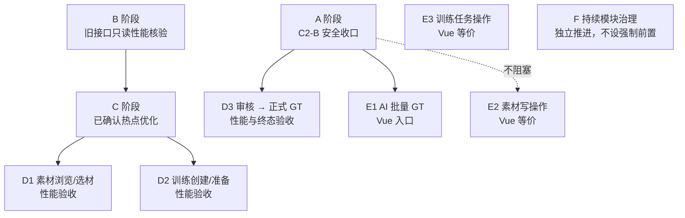

# 畅联云算法训练平台｜架构演进路线与阶段验收（2026-11-21）

> **定位**：统一后续开发顺序与放行条件。本文回答"先做什么、后做什么、每阶段怎样才算完成"，不回答"什么时候全部做完"。
>
> **不提供工期与完成百分比。** 所有阶段以**验收门槛**放行，不以日期放行。
>
> 标识：`EXISTING` 已存在；`PROPOSED` 建议、未经签认；`TBD` 待定；`NOT VERIFIED` 无证据。
>
> 配套：[架构与性能深度审计](PLATFORM_ARCHITECTURE_AUDIT_20261121.md)、[20 万级性能验收规范](../performance/PLATFORM_SCALE_ACCEPTANCE_20261121.md)。

---

## 1. 使用方式

1. 每次推进**一个阶段或一条独立工作流**；有依赖的阶段未放行时，不得开始依赖它的工作；无依赖的阶段可并行（见第 3 节）。
2. 每阶段开始前确认：基线 SHA、工作区状态、**所依赖阶段**的退出条件是否真实满足（不是"上一阶段"）。
3. 每阶段结束时更新[接续入口](AI_DEVELOPMENT_HANDOFF.md)，写明：改了什么、验证了什么、没验证什么、下一阶段前置。
4. 状态用 `NOT_STARTED / IN_PROGRESS / FUNCTIONAL_COMPLETE` + `CI_PENDING / ACCEPTED / BLOCKED / AWAITING_USER_APPROVAL` 双列，禁止用"基本完成"。

---

## 2. 当前确切状态（2026-11-21）

| 项 | 状态 |
|---|---|
| 分支 / HEAD | `feature/external-algorithm-publishing` / `ba3cd5773604859cb6fe150fee8fd713a37badb0` |
| 远端 | 与本地一致（只读 `ls-remote` 核验） |
| 该 SHA 的 CI | 48 个 check-suite，未检索到 `failure`；仅代表已提交代码 |
| 工作区 | 本轮提交后干净；仅保留 4 份未跟踪设计文档 |
| C2-B | 后端与 Vue 已实现；真实浏览器 205→201 三批隔离联调通过；生产 Worker 生命周期与现场验收未完成 |
| Vue 迁移 | 8 条具名原生业务路由（复用 7 个页面组件）；18 个 opt-in 试点；其余菜单进入 legacy 中转 |
| 20 万素材 | 有**隔离**元数据与选材测试；**生产未验收**（`NOT VERIFIED`） |
| 数据库 | SQLite 保留；无迁移授权、无迁移动作 |
| 旧入口 | 保留，默认 `/` |

**没有任何一项处于 `ACCEPTED`。** 这是当前最重要的状态事实。

---

## 3. 阶段依赖

阶段之间**不是强制串联**。只有"安全前置"与"证据前置"才构成依赖；其余允许并行。

**依赖说明**：

- **A 与 B 相互独立**：C2-B 收口不阻塞旧接口的只读性能观测；旧接口核验不修改 C2-B 代码。
- **B → C**：只优化 B 已确认的热点证据；没有证据不做优化。
- **C → D1/D2**：性能修复后用统一规范验收；D1/D2 各自独立，不互相等待。
- **A → D3**：审核→正式 GT 的终态可信度依赖 A；D3 完成前不得宣称该链路已验收。
- **A → E1**：AI 批量 GT 的 Vue 入口依赖 C2-B 的后端合同。
- **A 不阻塞 E2/E3**：素材写操作、训练任务操作与 C2-B 无直接依赖，可独立推进；E2 与 E3 之间也不设强制先后。
- **按具体功能确定依赖，不做笼统结论**：E4（复杂审核：批量消歧、转池、撤销）依赖 E1，而 E1 依赖 A，因此 **E4 间接依赖 A**；E5（转换/交付执行）、E6（标签/配置/节点）与 A 无直接依赖，但若涉及正式 GT 写入，仍受 A 的安全前置约束。**不得表述为"E2–E6 全部不依赖 A"。**
- **D 不阻塞 E**：20 万整体性能验收未完成时，独立 Vue 功能仍可开发与验收；但不得宣称"已替代生产主入口"。
- **F 独立推进**：F 是持续模块治理，**不设任何前置阶段**，图中不画从其他阶段指向 F 的依赖箭头；按独立风险与接口边界推进。

**并行纪律**：

1. 同一文件、同一业务 Owner 不得同时修改。
2. 共享 `app.py`、`TaskRepository`、`AnnotationRepository`、`CandidateStore` 的改动必须串行，避免冲突与语义漂移。
3. 并行阶段各自独立提交、独立验证；合并前由同一审查者看完整 Diff。
4. 并行不得绕过安全前置：A 的 GT/终态问题未关闭前，任何写正式 GT 的**新入口**都不得上线。

### 3.1 命名消歧：C2-B 缺陷 D1/D2 与性能验收 D1/D2

本文件存在两组同名编号，含义完全不同，**不得互相引用**：

| 编号 | 所属 | 含义 |
|---|---|---|
| D1 / D2（C2-B 缺陷） | 第 4 节 A 阶段 | D1 取消对账 `completed_batches` 多算并漏报；D2 不可验证证据缺少有界重试与阻断态 |
| D1 / D2（性能验收） | 第 7 节 D 阶段 | D1 素材浏览与选材；D2 训练创建与准备 |

**约束边界**：

- C2-B 缺陷 D1/D2 只约束 **C2-B 批量入口**（`ANNOTATION_FORMAL_BULK`）。
- **不无条件阻断既有安全 GT 写入业务**：普通人工 1–100 张正式 GT 入库、既有单图采用/拒绝、既有审核与回执路径均可照常使用；
- 只有"新增的、走 C2-B 批量链路的正式 GT 写入口"必须等 A 关闭。

---

## 4. A 阶段：C2-B 安全收口

### 4.1 目标

把"冻结选择后的后台分批正式 GT 入库"从本地候选实现变成**可提交、可验收**的合同。

### 4.2 必要性

- 当前唯一可能"把未完成说成完成"的领域。
- 它直接写正式 GT，错误代价最高。
- 它的终态语义会影响后续所有"审核→训练"链路的可信度。

### 4.3 前置条件

- 用户确认 C2-B 继续推进（不是延期）。
- 工作区已做只读备份：`git diff` 导出、5 个未跟踪文件复制到仓库外、桌面 patch 与 `git diff` 差异核对。
- 明确"不得在未备份情况下执行 reset/clean/stash/checkout"。

### 4.4 涉及模块

| 模块 | 角色 |
|---|---|
| `platform_core/annotation_bulk_execution.py` | 执行任务、绑定、进度、终态 |
| `platform_core/annotation_bulk_commit.py` | 批次内核、取消对账、审计 |
| `platform_core/annotation_bulk_intents.py` | C1 不可变意图与指针 |
| `platform_core/task_runtime/fenced_repository.py` | GT 写入屏障、进度发布 |
| `platform_core/task_runtime/repository.py` | 任务状态、取消、回收 |
| `platform_core/task_runtime/scheduler.py` | 领取、对账分支 |
| `platform_core/annotation_task_service.py` | Handler 注册 |
| `app.py` | 执行/查询/取消 API |
| `tests/api/test_ai_review_workbench.py` | 定向回归 |

### 4.5 风险

| 风险 | 说明 | 缓解 |
|---|---|---|
| 数据风险 | 取消对账计数错误会让"已完成"与真实 GT 不一致 | 先修 D1，再动其他 |
| 活性风险 | 不可验证证据无限重领 | D2 设计有界重试与阻断态 |
| 语义风险 | 成功语义不清导致验收争议 | D5 先写清"成功"的定义 |
| 丢失风险 | 工作区被误清理 | 备份先行 |
| 范围风险 | 顺手改状态机/锁域 | 只改已确认项，其余登记 |

### 4.6 已有能力

唯一执行任务、不可变绑定、执行/GET/取消 API、CPU Handler、100 张续批、取消只读对账、SUCCEEDED/CANCELLED 终态、进度投影——均已在工作区代码中。

### 4.7 验收标准

必须全部满足：

1. **D1 关闭**：取消对账只统计有 `receipts + journal` 的批次；"已进屏障未写 GT"的批次进入 candidate-only；有"active_batch 已写、GT 未提交即取消"的测试。
2. **D2 必须实现并验证，不能只交方案**：不可验证证据要有**可验证的安全阻断**（明确状态、可观测原因、不继续写 GT）、**恢复处理**（人工/自动恢复入口，保留回执与执行身份）与**必要定向测试**（反复重领不放大写、阻断态可恢复、恢复后不重复写 GT）。只给出设计而未实现时，本阶段保持 `BLOCKED`，不得放行。
3. **D3 合同确定**：QUEUED 取消要么零 GT 对账终态，要么独立"等待对账"状态；二者都要有测试与用户可见语义。
4. **D4 关闭**：删除重复测试函数；测试数量与实际执行一致。
5. **D5 语义与等级确定**：明确"成功"= 本次执行写完全部冻结 GT，还是"成功时当前 GT 仍与回执一致"；并据此判定该时间窗口是否构成生产风险。**事实已确认，但等级 `TBD`，不得先定为 P0**；按语义补测试（含"audit 后外部 GT 写"）。
6. **D6 关闭**：`committed_images` 不再由批次数推算；证据缺失时返回明确的"未证明"而非数字。
7. **异常分类完成**：逐条列出哪些异常进入终态、哪些留在 RUNNING、哪些阻断；有定向测试。
8. **201 张三批**：**201 = 100 + 100 + 1** 全部成功；若使用 203 张夹具，需说明"选中 203 张、排除 2 张、最终入库 201 张"，并将 203/2/201 分别断言。此外崩溃重领、候选先写 GT 后写、越权、幂等并发、取消重领全部通过。
9. **CI**：当前 HEAD `1fa5119b` 已绿，但那是**已提交代码**；C2-B 尚未提交，**没有任何 CI**。提交后查一次准确 SHA 快照；未完成写 `CI_PENDING`。

### 4.8 不可修改的合同

- 不得放宽 GT 版本/摘要 CAS。
- 不得删除 GT 回执或候选日志。
- 不得用"重试成功"掩盖未写。
- 不得改变普通 1–100 张手动入库路径。
- 不得远程 Node Agent 领取（同机锁域边界）。
- 不得在 HTTP 请求内逐批写 GT。

### 4.9 退出

`FUNCTIONAL_COMPLETE` + 定向测试通过 + 一次 CI 快照 + 文档更新。**不要求**现场验收；现场验收属于 D 阶段。

---

## 5. B 阶段：旧接口真实性能核验

### 5.1 目标

确认旧全量接口是否仍在**关键用户动作**上被触发，并量化其真实成本。

### 5.2 必要性

- 已发现代码级无界读取，但**生产触发范围与耗时未验证**。
- 不核验就优化，可能改错地方；不核验就断言"根因"，是错误结论。

### 5.3 前置条件

- **不要求 A 阶段退出**：本阶段只读观测，与 C2-B 收口可并行。
- 获得生产只读观测授权（现有监控、只读 HAR、日志）。
- 明确观测窗口与脱敏要求。

### 5.4 涉及模块 / 接口

| 接口 | 关注点 |
|---|---|
| `GET /api/projects/{pid}` | 全量素材 + 逐图 GT |
| `GET /api/projects/{pid}/datasets` | 全量素材 + 全量 GT 聚合 |
| `GET /api/projects/{pid}/images` | 全量素材 + 逐图 `stat` + 回写 |
| `GET /api/v52/projects/{pid}/annotation-index/status` | 仅为计数读全表 |
| `static/app.js` 的 `loadRelated()` | 写后刷新是否触发上述接口 |
| `frontend/src/app/Materials.vue` | 新页面是否仍调用旧全量 |

### 5.5 风险

| 风险 | 缓解 |
|---|---|
| 观测本身影响生产 | 只读、采样、限定窗口 |
| **主动调用带补写副作用的 GET** | `GET /api/projects/{pid}/images` 会回写缺 `size_bytes` 的素材元数据，**不是无副作用只读**；生产侧禁止为测试主动调用，主动复现只在隔离环境 |
| 把测试环境当生产 | 记录环境与并发背景 |
| 只看到"慢"看不到调用方 | 采集调用栈/请求链，不只看单接口 |

### 5.6 已有能力

- `performance_diagnostics` 的 `stage()` / `measure()` 埋点。
- `Server-Timing` 支持。
- v61 分页已存在，可作为对照路径。

### 5.7 验收标准

1. 列出**生产实际调用**的旧全量接口清单，附证据（HAR/日志/请求计数）。
2. 每个接口给出：调用频率、单次耗时、响应字节、是否在关键动作上。
3. 明确区分"代码存在"与"生产触发"。
4. 结论二选一：**需要优化**（有数据）或**暂不优化**（有数据证明影响小）。
5. 不修改业务代码（本阶段只观测）。
6. 生产侧**不得为测试主动调用**有补写副作用的 GET（如 `/images`）；只观察既有日志/监控/授权 HAR，主动复现只在隔离环境。

### 5.8 不可修改的合同

- 不得为了观测改生产配置、重启服务、触发写入。
- 不得用测试环境数据替代生产观测结论。

### 5.9 退出

形成一页观测报告，登记到本文与[验收规范](../performance/PLATFORM_SCALE_ACCEPTANCE_20261121.md)。

---

## 6. C 阶段：大数据量性能优化

### 6.1 目标

只针对 B 阶段确认的热点，逐项优化，并给出同环境前后对比。

### 6.2 必要性

- 避免"没有证据的大规模重构"。
- 保证每次优化都能回退、都能验证。

### 6.3 前置条件

- B 阶段退出，热点清单确定。
- 有可复现的隔离夹具（1 万/5 万/20 万）。
- 明确每项优化的验收指标。

### 6.4 候选优化项（`PROPOSED`，按证据排序）

| 项 | 方向 | 必须保留 |
|---|---|---|
| C1 | 旧全量接口改为分页/投影/后台聚合 | 统计口径、GT 语义 |
| C2 | `mutate()` 改定点 `mutate_ids` / `patch_filtered` | 事务原子性、revision |
| C3 | 缩略图哈希复用与锁粒度 | **内容完整性**，不得用 `size+mtime` 替代 SHA |
| C4 | 选材 usage 状态投影 / 索引 | 历史资格、负样本、泄漏规则 |
| C5 | 角色 counts 缓存与 deferred 默认 | 筛选结果**完整语义** |
| C6 | 前端深分页改用 `next_cursor` | 排序稳定、不漏不重 |
| C7 | 冻结写入减少二次回读与触发器 | 清单 sha256、配额 |
| C8 | 任务列表批量队列位置推广 | 队列位置准确性 |
| C9 | 稀疏类别索引/查询计划 | **长尾类别必须可用** |

### 6.5 风险

| 风险 | 说明 |
|---|---|
| 语义漂移 | 优化改变筛选结果或资格判定 |
| 稀疏类别被"优化掉" | 用扫描预算拒绝低频查询会破坏长尾业务 |
| 内容完整性下降 | 用元数据替代哈希 |
| 度量失真 | 只测冷或只测暖、换机器对比 |

### 6.6 已有能力

分页、keyset 游标、计数缓存、延迟计数、稀疏 GT 驱动、token 索引、批量队列位置、内容寻址缩略图、启动快照复用。

### 6.7 验收标准

1. 每次改动一个热点，独立提交。
2. 同环境、同数据、同并发的前后对比，含 P50/P95、SQL 数、扫描行数、响应字节。
3. 功能回归：该域定向测试全绿。
4. 稀疏类别与长尾场景**有专门用例**，证明未被截断。
5. 若收益不显著，如实记录并回退或保留原状。

### 6.8 不可修改的合同

- GT/版本/来源/历史/负样本校验不得跳过。
- 筛选结果不得静默截断。
- Train/Val/Test 隔离与防泄漏不得放宽。
- 冻结清单与回执不得重建/伪造。
- 不得为了让指标好看而降低页大小或关掉统计。

### 6.9 退出

每项优化有前后对比记录；无未解释的功能回退。

---

## 7. D 阶段：完整业务链性能验收

### 7.1 目标

按[验收规范](../performance/PLATFORM_SCALE_ACCEPTANCE_20261121.md)在 20 万规模、真实数据代表性下跑完整链，形成可签认结论。

### 7.2 必要性

- 单点优化不等于业务链流畅。
- 用户感知的是"从选材到训练创建"的整条链，不是单个 API。

### 7.3 前置条件

- **D1/D2（素材浏览、训练创建）**：**不要求先完成 C 阶段优化**；先按现状测量形成基线，只有测量显示不达标时才进入 C 优化并复测。已有优化可复用，但不作为验收前置。
- **D3（审核 → 正式 GT）**：A 阶段退出（C2-B 缺陷 D1/D2 关闭；与本节性能子集 D1/D2 无关）。**既有普通 1–100 张正式 GT 入库与单图审核路径不因 A 被阻断**，可单独测量。
- 有授权的隔离环境（或脱敏镜像）+ 代表性数据；**测试数据以脱敏真实业务分布为主**，合成比例仅用于补充压力测试。
- 阈值已签认（否则只能 `NOT VERIFIED`）。
- D1/D2 与 D3 可分别验收，不必同时进行。

### 7.4 涉及范围

素材库 → 搜索/筛选 → 跨页选择 → 2 万冻结 → 训练创建/准备 → AI 审核 → 正式 GT 入库 → 任务列表 → 批量治理。

### 7.5 风险

| 风险 | 缓解 |
|---|---|
| 数据不代表性 | 以脱敏真实业务分布为主，合成比例仅补充压力测试（见规范第 4 节） |
| 只测暖态 | 冷/热分组 |
| 样本不足 | ≥30/组 |
| 结论外推 | 只对同规模同环境成立 |

### 7.6 已有能力

全部隔离夹具、验收场景表、指标分层、结果模板。

### 7.7 验收标准

1. 必测场景（M01–M16）全部有结果行。
2. 冷/热分组齐全，N 明确，分位算法写明。
3. 阈值已签认；未签认则整表 `NOT VERIFIED`。
4. 无 P0/P1 功能回退。
5. 关键 SQL 计划有证据。
6. 由用户或授权现场负责人签认。

### 7.8 不可修改的合同

- 生产只读观测；写入/故障注入只在隔离环境。
- 不得用隔离结果冒充生产。
- 不得隐去失败样本。

### 7.9 退出

形成带 SHA、环境、数据代表性、分位口径、签认的验收记录。**只有此时**才允许说"20 万素材性能验收通过"。

---

## 8. E 阶段：Vue 功能等价

### 8.1 目标

按业务链把仍依赖旧工作台的高频操作迁到原生 Vue，**不删除旧入口**，直到功能等价被证明。

### 8.2 必要性

- 双运行时是长期成本：两套状态、两套选择、两套回执。
- 用户已在用新页面，但关键写操作仍跳回旧页，体验割裂。

### 8.3 优先级（按用户实际痛点，`PROPOSED`）

| 顺序 | 功能 | 为什么优先 | 依赖 |
|---|---|---|---|
| E1 | AI 批量正式 GT 入库的 Vue 入口 | C2-B 的核心业务价值；当前只能回旧工作台 | A 阶段 |
| E2 | 素材写操作（上传/ZIP/标注/清洗/治理/删除审核） | 最高频、最影响日常 | 无 |
| E3 | 训练任务操作（停止/恢复/暂停/日志） | 训练期高频，旧页跳转成本高 | 无 |
| E4 | 复杂审核（批量消歧、转池、撤销） | 与 E1 同一业务链 | E1 |
| E5 | 模型转换/交付执行 | 低频但关键 | 无 |
| E6 | 标签管理、配置、节点 | 低频 | 无 |

**并行约束（按功能确定，不做笼统结论）**：E1 依赖 A；**E4 依赖 E1，因此间接依赖 A**；E2、E3、E5、E6 不依赖 A 或 D，可与 A/B/C 并行。任何涉及正式 GT 写操作的子功能，仍受 A 的安全前置约束（不得在 C2-B 缺陷 D1/D2 未关闭时上线新的批量 GT 写入口）。

### 8.4 风险

| 风险 | 说明 |
|---|---|
| 功能丢失 | 迁移时漏掉参数、校验、默认值 |
| 状态分裂 | 新旧各存一份选择/草稿 |
| 安全上下文 | 新 AI 正式 GT 依赖 `crypto.subtle` + `navigator.locks`，内网 HTTP 不可用 |
| 提前删旧 | 等价未证明就下掉旧入口 |

### 8.5 已有能力

8 条具名原生路由已在运行（复用 7 个页面组件）、算法卡片、训练创建、AI 单图决定、跨页冻结、素材只读、项目负样本池、报告/评测只读。

### 8.6 验收标准

1. 每个功能有**功能等价清单**：参数、默认值、校验、错误、回执、返回路径。
2. 定向测试（API + 浏览器）通过。
3. 旧入口仍可用，且可一键返回。
4. 跨页选择、刷新、退出、返回不丢状态。
5. 安全上下文问题有明确方案（HTTPS 部署或本地凭据桥），不得静默失败。
6. 该阶段 SHA 的 CI 快照。

### 8.7 不可修改的合同

- 菜单名称/分组/顺序、算法库卡片、训练全参数、Train/Val/Test、负样本、审核消歧、任务停止/恢复、报告/评测、转换/发布能力不得删减。
- 不得新建第二套业务状态 Owner。
- 不得因为 Vue 有页面就删除旧入口。

### 8.8 退出

按功能逐项记 `FUNCTIONAL_COMPLETE` + `CI_PENDING/ACCEPTED`；全部高频链等价后，才讨论退役旧入口（需用户批准）。

---

## 9. F 阶段：后端架构持续治理

### 9.1 目标

降低耦合、收敛热点、保持投影一致，并在有证据时评估数据库演进。

### 9.2 必要性

- `app.py` 340 路由仍是最大维护成本。
- 投影漂移是隐性数据风险。

### 9.3 内容

| 项 | 说明 |
|---|---|
| F1 | 新路由不再进 `app.py`，按域抽 Router（AST 等价 + 合同测试） |
| F2 | 收敛旧全量接口，改为分页/投影/后台任务 |
| F3 | 投影一致性诊断（行数/摘要/抽样比对），只读 |
| F4 | 可观测性：`stage()` 埋点、SQL 计数、锁等待 |
| F5 | PostgreSQL 评估（见第 10 节） |
| F6 | 文档收敛：三份正式文档 + 两份台账，不再新增长交接文 |

### 9.4 风险

| 风险 | 缓解 |
|---|---|
| 抽取改变行为 | AST 对比 + 原断言保留 |
| 投影诊断变成新写入 | 只读、不建第二事实源 |
| 文档再次膨胀 | 固定文档集，历史归档不续写 |

### 9.5 验收标准

1. 每抽一个 Router：AST 等价、路由唯一、原测试改指向注册端点后全绿。
2. 旧全量接口每次收敛都有前后对比。
3. 投影诊断能报出漂移，且不修改数据。
4. 文档更新只增量、不复制。

### 9.6 不可修改的合同

- 唯一 Owner 不变。
- 不改 Schema/状态机/锁域，除非单独设计并批准。
- 不为拆分而拆分，不引入空转发层。

---

## 10. PostgreSQL 评估（`TBD`）

**当前不迁移。** 触发评估需要真实证据，不是"数据变多"。

### 10.1 评估维度

| 维度 | 需要回答的问题 |
|---|---|
| 写竞争 | 是否出现用户可见的 `busy`/锁等待？多进程写是否常态化 |
| 部署形态 | 是否需要多主机共享权威库？单机文件锁是否成为硬边界 |
| 事务需求 | 是否存在跨域强一致事务需求 |
| 数据增长 | 单域热表是否达到百万级且分页/索引无法满足 |
| 备份恢复 | 是否需要 PITR、逻辑复制、在线 DDL |
| 运维能力 | 是否有 DBA/监控/回滚演练条件 |
| 迁移单元 | Task + GT + 冻结是否愿意一起设计 |

### 10.2 迁移原则（若启动）

1. 单域先行，禁止双写。
2. 先 Owner 审计，再一致性副本、只读影子、单写切换、对账、回退窗口、退役。
3. `ATTACH` 依赖必须在目标库内解决，不能改成跨库 HTTP。
4. Task/GT/冻结链路需要独立授权。
5. 详见 [P2 数据 Owner 与 PostgreSQL 准备](P2_DATA_OWNERS_AND_POSTGRESQL_PREPARATION_20261117.md)。

### 10.3 不得做的事

- 未经批准添加驱动/DDL/双写。
- 把素材表单独迁移就当"已支持 PostgreSQL"。
- 用迁移替代性能优化。

---

## 11. 明确不做

| 不做 | 原因 |
|---|---|
| 重写 FastAPI / 前端 | 代价集中在 14 种任务类型构成的执行链，无收益证据 |
| 拆微服务 | 破坏同库事务与同机锁域 |
| 引入 Redis 作为事实源 | 正式 GT/任务/冻结必须落唯一权威 |
| 引入 Celery / Temporal | 现有 lease/attempt/fencing 已覆盖；第二套状态机风险高 |
| 全面 PostgreSQL 迁移 | 无授权、无证据 |
| 新建素材库/标注库/任务库/Registry | 制造双写与漂移 |
| 删除旧入口 | 功能等价未证明 |
| 无证据的大规模性能重构 | 可能改错地方 |
| 长期维护超长交接文档 | 应以三份正式文档为准 |

---

## 12. 风险观察清单

持续观察，不自动升级为开发任务：

1. 双运行时导致的选择/草稿/回执分裂。
2. Vue 正式 GT 的安全上下文限制。
3. 冻结选择因全局 revision 频繁失效。
4. 选材全池缓存的常驻内存。
5. 缩略图冷路径的 IO 放大。
6. 任务列表 N+1 在其他端点的残留。
7. 投影漂移（GT ↔ 素材投影 ↔ 标签引用 ↔ usage token）。
8. 文档状态与代码再次脱节。
9. 20 万真实数据与隔离数据的差距。
10. 国产芯片/异构后端的目标差异。

---

## 13. 放行规则

### 13.1 阶段内

- 代码、必要定向测试、Git、文档四者齐备才允许结束。
- 只查一次准确 SHA 的 CI；未完成写 `CI_PENDING`，不轮询、不重跑。
- 已知失败只分析失败 Job，不用其他 SHA 的绿掩盖。

### 13.2 阶段间

- 只有**有依赖关系的阶段**（B→C、C→D1/D2、A→D3、A→E1）未放行时，才不得开始依赖它的代码。
- 无依赖关系的阶段（A 与 B、A 与 E2/E3、D 与 E2/E3、F 与任意阶段）允许并行；并行必须遵守第 3 节的"同一文件/Owner 不并行"纪律。
- 每阶段结束更新[接续入口](AI_DEVELOPMENT_HANDOFF.md)与本文件"当前状态"。
- 任何"降级/跳过校验"的提议一律拒绝。

### 13.3 什么时候可以说"完成"

| 说法 | 需要 |
|---|---|
| 功能完成 | 定向测试通过 + 该 SHA 的 CI 快照（当前 HEAD 已绿，但必须说明该功能是否被 CI 实际覆盖） |
| 验收通过 | 上述 + 现场/隔离验收记录 + 用户签认 |
| 20 万素材浏览/选材达标（L1） | 验收规范 11.2 节 L1 条件全部满足 |
| 完整平台全链路达标（L2） | 验收规范 11.2 节 L2 条件全部满足 |
| 可以迁移数据库 | 第 10 节维度全部有证据 + 用户批准 + 单域方案 |

**其余情况一律写 `NOT VERIFIED` 或 `CI_PENDING`。**

---

## 附录：阶段与文档的对应

| 阶段 | 主要证据落点 |
|---|---|
| A | [审核工作台](../AI_REVIEW_WORKBENCH_2026_11_06.md) + [接续入口](AI_DEVELOPMENT_HANDOFF.md) |
| B | 本文 + [验收规范](../performance/PLATFORM_SCALE_ACCEPTANCE_20261121.md) 第 2 节索引 |
| C | [验收规范](../performance/PLATFORM_SCALE_ACCEPTANCE_20261121.md) + 新增日期化性能文件 |
| D | [验收规范](../performance/PLATFORM_SCALE_ACCEPTANCE_20261121.md) 第 9 节模板 |
| E | [Vue 迁移矩阵](VUE_M0_FUNCTION_API_MATRIX_20261118.md) + [功能保留](EXISTING_FEATURE_PRESERVATION.md) |
| F | 本文 + [P2 数据 Owner](P2_DATA_OWNERS_AND_POSTGRESQL_PREPARATION_20261117.md) |

## 2026-11-21 阶段验收记录（历史快照）

- 当前 HEAD：`b74766b909124be757691a32766dbd9b8062a0e1`（本阶段提交 `43aaa14e`、`6134bfb5`、`b74766b9`）。
- C2-B：不可变意图、幂等 `request_id`、GT CAS、批次回执与恢复已实现；真实浏览器 205→201 三批隔离联调通过（真实 uvicorn + 独立测试 Worker 进程 + 真实 GT/journal/回执）。
- 前端：封存只在同正文幂等 POST 成功后才可执行；409 冲突在刷新后仍保持阻断；`execution_attempted` 的未知创建状态跨刷新保留。
- 性能：`/images` 20 万返回约 106MB/2.2s、`/datasets` 约 6.5s、`/projects` 约 4.6s（隔离合成、无 GT 的 legacy 回退路径）；标签编辑已改为仅刷新标签，不再触发 `loadRelated()` 全量 `/images`。
- 未实施：FTS5、`/images`/`/datasets`/`loadRelated` 的结构性治理、生产 Worker 生命周期与生产现场验收。

## U3 Picker 迁移状态（2026-11-28 校正）

| 阶段 | 状态 | 证据 |
|---|---|---|
| U3 基础 | 已验收 | 素材/GT/池迁移与对账 |
| U3-P0 | 已验收、冻结 | Schema V4；57 项 PG 合同 |
| U3-P1 | 已验收 | 只读 Provider、项目绑定、Owner 失败关闭；41 项 |
| U3-P2 | 本地实现完成、待独立验收 | 业务读取合同（历史/角色/用途/确认/分页/冻结等价）；24 项 |
| U3-P3-A | 设计完成 | 增量同步前置合同，未写 Worker/Schema |
| U3-P3-B1 | 已实现、待独立验收 | 事务内不可变 Change Log（三流、tombstone、信封摘要）；审计收口完成 |
| U3-P3-B2 | 已实现、待独立验收 | PG 有界增量消费、baseline/幂等/缺口/STALE；真实 PG 定向 12 项 |
| U3-P3-B3 | 已实现、待独立验收 | HWM 同源快照、baseline 游标、跨流依赖、READY 原子发布 |
| U3-P3-B4 | 已实现、待独立验收 | 中断重放、受控完整重建、最小只读诊断 |
| U3-P4-A | 测量能力完成、200k 已测 | 200k artifact：exact 5.6–7.2s、deferred 69/116ms；冻结/增量一致性通过 |
| U3-P4-B | 第二轮优化已实现、复测待 CI | payload 复用 + exact count-only 游标续算；GT/回执/history/Task 判定不变 |
| U3-P4-C | 未完成 | 分段诊断/非空角色/正式冻结三方差分/并发证据仍未收口 |
| U3 同步运行 | 已实现、默认关闭 | `u3_sync_runner` 项目目录绑定、总批次/时间预算、停止事件、项目隔离 |
| Change Log 治理 | 只读诊断已实现 | HWM 缺失/固定读事务/物理库去重；safe_to_delete=false |
| 部署预检 | 只读预检/回退准备已实现 | SQLite query_only + PG 只读事务 + 完整表检查；未部署 |
| Service Nodes 前端 | 定向修复 | Playwright setPage 前等待 fixtureReady；失败用例通过 |
| U3-P5 | 未授权 | 生产读取切换 |

SQLite 仍是业务 Owner；PostgreSQL 仍是只读投影；未启用生产读取；VERSION 42.24.592。\n\n
## 模型转换一致性 Q1–Q3 状态（2026-11-28）

| 专项 | 状态 | 证据 |
|---|---|---|
| Q1 类别身份 | 已实现、待独立验收 | 所有可取得类别信息的目标冻结 `label_binding`（class_id/order/code/schema/source SHA）；manifest 不可变携带 |
| Q2 预处理/检测合同 | 部分实现、待独立验收 | `preprocessing_contract`/`output_contract` 进入证据；复用 canonical RGB LetterBox 与检测差异比较；不扩展全部架构 |
| Q3 准入边界 | 已实现、待独立验收 | 冻结类别合同下 unknown/mismatch/conflict 拒绝；历史 unknown 保留不伪补证 |
| 真实硬件 | HARDWARE_PENDING | 无 BM1684/RKNN/Ascend 板端证据，编译/ONNX Runtime 不等于硬件验证 |

VERSION 42.24.592；未启用正式 PG Picker，未操作生产或 4070/A800。
